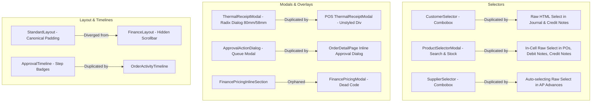

# Cross-Module UI/UX Inconsistency Matrix

**Document ID:** `AUDIT-07-MATRIX`  
**Application:** DNS Import & Export ERP (Client Frontend)  
**Scope:** System-Wide Pairwise Comparison Across 6 Business Modules  
**Status:** Synthesized from 80 Findings across Audits 01 through 06  
**Date:** October 2026  

---

## 1. Executive Overview

This matrix synthesizes the evidence collected across the individual module audits (`01-purchasing-audit.md` through `06-reports-audit.md`). It moves beyond isolated route-by-route evaluations to provide direct pairwise comparisons of equivalent user tasks, competing UI patterns, divergent component implementations, and conflicting business logic representations across the entire ERP platform.

A total of **16 Major Architectural Inconsistency Categories** have been identified where equivalent user intents result in contradictory visual styling, interaction paradigms, or data integrity failures.

---

## 2. Master Cross-Module Inconsistency Matrix

| Matrix ID | Workflow / Pattern Domain | Competing Implementation A | Competing Implementation B | Affected Routes | Root Cause & Operational Impact | Canonical Target Pattern |
| :--- | :--- | :--- | :--- | :--- | :--- | :--- |
| **CM-01** | **Supplier Master Management** | `/purchasing/suppliers` (`PurchasingSuppliersPage.tsx`) renders PO metrics, active orders modal, and "Create PO" shortcut. | `/finance/suppliers` (`SuppliersPage.tsx`) renders banking details (SWIFT, IBAN), tax IDs, and Delete actions. | `/purchasing/suppliers` `/finance/suppliers` | Duplicate maintenance of identical entity directory. Purchasing cannot view bank details; Finance cannot view purchase commitments. | Unified `SupplierHubPage` with dual tabs: "Commercial & Orders" and "Financial & Banking", sharing a single `SupplierService`. |
| **CM-02** | **Product & SKU Selection** | Canonical `ProductSelector` / `ProductSelectorModal` (with search, category, stock indicators). | Unsearchable native HTML `<select>` mapping `MOCK_PRODUCTS` in table cells. | `/purchasing/orders/new` `/finance/ap/debit-notes` `/finance/ar/credit-notes` | PO creation and AP/AR debit/credit notes use raw HTML `<select>` inside table rows, freezing or breaking with 500+ SKUs. | Mandate `ProductSelectorModal` with combobox search across all transactional line-item grids. |
| **CM-03** | **Customer Selection & Sub-Ledger Tagging** | `CustomerSelector` combobox querying dynamic `CustomerService`. | Static `MOCK_CUSTOMERS.map(...)` hardcoded into native `<select>` dropdowns. | `/finance/journal/new` `/finance/ar/pdc-vault` `/finance/ar/credit-notes` | Universal journal engine and credit notes cannot tag live customers created through CRM or POS. | Standardize on shared `CustomerSelector` with credit ceiling and outstanding balance preview. |
| **CM-04** | **Thermal Receipt Printing** | Radix `Dialog` with dark slate styling, 80mm/58mm switch, barcode, and print preview. | Fixed unstyled `div` modal with white card styling, missing roll width switch. | `/payments` (Payments module) `/pos` (POS module) | Conflicting customer receipt formatting. POS cashiers print raw text while back-office payments print formatted 80mm receipts. | Decommission POS modal; promote `features/payments/ThermalReceiptModal.tsx` as system-wide standard. |
| **CM-05** | **Line-Item Editing & Grids** | Modern clean table with sticky header, live subtotal badges, and inline discount chips (`OrderCreatePage`). | Monolithic multi-card expandable product inspector with unstyled `<select>` (`VendorBillCostingPage`). | `/orders/new` `/quotations/new` `/purchasing/orders/new` `/finance/ap/bills/new` | Purchasing and Landed Costing use heavy, unaligned form structures compared to streamlined Sales Orders. | Standardize on `DocumentLineItemsTable` with uniform column sequence: SKU, Description, Qty, Unit Price, Disc %, Tax %, Total. |
| **CM-06** | **Currency & Monetary Display** | `formatCurrency(val)` from `formatters.ts` outputs `Rs. #,##0.00`. | `formatCurrencyLKR(val)` from `exportUtils.ts` outputs `LKR #,##0.00` / `SLRs`. | All operational modules vs all analytical reporting tabs (`/reports`) | Inconsistent currency prefixes throughout the app. System reads like two different software products. | Standardize on `formatCurrency()` across all 47 routes (`Rs. #,##0.00` with `tabular-nums`). |
| **CM-07** | **Multi-Currency & FX Apportionment** | Currency selector (USD, EUR, CNY, LKR) and exchange rate inputs (`PurchaseOrderCreateEditPage`). | 100% nominal LKR assumption with zero currency or FX fields (`VendorBillCostingPage`). | `/purchasing/orders/new` `/finance/ap/bills/new` | Overseas vendor bills entered as nominal values without FX conversion, corrupting landed unit costs by orders of magnitude. | Introduce mandatory Foreign Currency & FX Rate inputs to `VendorBillCostingPage` with automatic base LKR conversion. |
| **CM-08** | **Approval Decision Execution** | Central `ApprovalActionDialog.tsx` with role escalation and history timeline. | Inline custom `Dialog` inside `OrderDetailPage.tsx` with conflicting submit button colors. | `/approvals` `/approvals/orders/:id` `/orders/:id` | Two conflicting modal dialogs for approving the same sales order, with different validation rules and styling. | Standardize on `ApprovalActionDialog.tsx` across both central queue and transaction detail views. |
| **CM-09** | **Approval History & Audit Timelines** | `ApprovalTimeline.tsx` with step badges and multi-actor history. | `OrderActivityTimeline.tsx` (orders) vs Raw Card Textarea (POs) vs None (GRNs). | `/approvals` `/orders/:id` `/purchasing/orders/:id` `/inventory/grn/:id` | Purchase orders and GRNs lack visual audit trails. Approvers cannot inspect prior rejections or escalation notes. | Promote `ApprovalTimeline.tsx` as the universal timeline component across Orders, POs, and GRNs. |
| **CM-10** | **Date Filtering & Range Pickers** | Quick preset buttons (`Today`, `Month`, `Quarter`, `Year`, `Custom`) in `ReportDateFilterBar.tsx`. | Two manual `<input type="date">` inputs without presets in `ReportsFilterToolbar.tsx`. | `/finance/reports/*` vs `/reports` | Disjointed reporting ergonomics. Business users in `/reports` must manually look up dates on a calendar. | Standardize on `UnifiedDateRangeFilter` featuring one-click presets and custom date pickers. |
| **CM-11** | **Print Layouts & Formal Export** | Formal statutory HTML printing (`reportPdfService`) with `CorporateReportHeader` and signature blocks. | Raw `window.print()` dumping unstyled web buttons, cards, and tabs (`ReportsFilterToolbar.tsx`). | `/finance/reports/*` vs `/reports` | General business reports print with navigation buttons, clipped tables, and no company credentials. | Standardize on printable report wrapper with `@media print` rules stripping interactive chrome. |
| **CM-12** | **Accounts Receivable Truth Sources** | Operational debt aging from `invoiceService.getAllInvoices()`. | Collector/Cashier debt from hardcoded `MOCK_OPEN_INVOICES` in `arService.ts`. | `/reports` (Collections Tab) `/finance/ar/approvals` `/finance/reports/balance-sheet` | Operational debt, collector queues, and balance sheet receivables (GL 1020) operate on three disconnected datasets. | Bind all AR workflows to a single Accounts Receivable sub-ledger service synchronized with GL 1020. |
| **CM-13** | **Inventory Valuation Truth Sources** | On-hand quantity multiplied by product master cost price (`InventoryAnalyticsTab.tsx`). | Balance Sheet GL Account `1100` (Inventory Asset) inside `MockFinanceRepository`. | `/reports` (Inventory Tab) `/finance/reports/balance-sheet` `/inventory/stock` | Executive reports show inventory valuation that has zero connection to the audited balance sheet. | Implement perpetual inventory journal entries linking physical goods receipts to GL 1100. |
| **CM-14** | **Stock Return Integration** | GL Journal voucher (Dr 1100 Inventory, Cr 5010 COGS) posted without physical movement. | Warehouse stock ledger in `inventoryService` receives no return movement. | `/finance/ar/credit-notes` `/inventory/stock` `/inventory/movements` | Credit notes with "Return to stock" adjust financial valuation but leave warehouse physical quantities unchanged. | Trigger `inventoryService.recordStockMovement('RETURN_INWARD')` upon posting stock-return credit notes. |
| **CM-15** | **Status Badge Color Semantics** | Semantic badge variants (`success` = green, `warning` = amber, `info` = blue, `destructive` = red). | Conflicting discrete badges (`InvoiceStatusBadge`, `OrderStatusBadge`, `PaymentStatusBadge`). | Application-wide across all list and detail pages | `PENDING` is yellow in some badges, blue in others, and amber elsewhere. Inconsistent lifecycle terminology. | Standardize on unified `StatusBadge` primitive with semantic status-to-color mapping table. |
| **CM-16** | **Global Layout Wrappers** | `StandardLayout.tsx` with mobile bottom-nav padding calculation (`pb-[calc(6rem+env(safe-area-inset-bottom,0px))]`). | `FinanceLayout.tsx` with `pb-24 sm:pb-20 md:pb-6` and hidden scrollbars (`[&::-webkit-scrollbar]:hidden`). | All modules vs `/finance/*` | Visual jump in viewport height and layout margins when switching between operational modules and Finance. | Standardize all modules on `StandardLayout.tsx` and eliminate redundant `FinanceLayout`. |

---

## 3. Deep-Dive Pairwise Comparisons

### 3.1 Sales Quotation vs. Sales Order Creation
- **Sales Quotations (`/quotations/new`):**
  - Uses 2-column header layout (Customer selector on left, Validity/Date on right).
  - Clean line-item table with Product combobox, unit price, quantity, discount %, and computed line total.
  - Clear summary box showing Subtotal, Tax (18%), Total Discount, and Grand Total.
- **Sales Orders (`/orders/new`):**
  - Expands line-item rows into multi-tier discount approval triggers.
  - Evaluates customer credit days and credit limits.
  - Implements loyalty tier discounts and commercial terms warnings.
- **Inconsistency:**
  Converting a Quotation to a Sales Order loses line-item discount justification notes and does not transfer customer commercial exceptions. Quotation lines allow free-form discount entry without displaying the customer's maximum discount ceiling, which then immediately blocks the Sales Order upon conversion.
- **Resolution:**
  Embed customer discount ceilings and credit indicators directly on the Quotation creation form.

### 3.2 Purchase Order vs. Sales Order Line-Item Editing
- **Sales Order Items (`OrderCreatePage.tsx`):**
  - Features dedicated `ProductSelectorModal` with live stock availability across warehouse and showroom.
  - Displays unit cost, proposed selling price, margin %, and maximum permitted discount.
  - Inline validation prevents selling below minimum floor price without Director escalation.
- **Purchase Order Items (`PurchaseOrderCreateEditPage.tsx`):**
  - Uses raw HTML `<select>` inside each table row.
  - Does not display historical purchase costs, supplier part numbers, or current warehouse reorder points.
  - Fails to validate multi-currency line items against foreign currency exchange rates (`PUR-006`, `PUR-010`).
- **Resolution:**
  Port the robust modal product selector from Sales Orders into Purchase Orders, customized with supplier SKU mapping and last purchase price reference.

### 3.3 Supplier vs. Customer Master Selection
- **Customer Selection (`CustomerSelector`):**
  - Searchable dropdown with customer code, name, phone, outstanding debt, and credit status pill.
- **Supplier Selection (`SupplierSelector` vs Native Select):**
  - Implemented as a searchable combobox in `PurchaseOrderCreateEditPage`.
  - Degrades to raw HTML `<select>` in `SupplierAdvancePaymentsPage` and `SupplierDebitNotesPage`.
  - Automatically pre-selects `suppliers[0]` on disbursement forms (`FIN-006`).
- **Resolution:**
  Deprecate raw HTML `<select>` tags for suppliers. Mandate the searchable `SupplierSelector` combobox across all purchasing and AP disbursement forms, with explicit validation preventing empty selection.

### 3.4 Financial Transaction Capture vs. Approval Queues
- **Manual Journal Vouchers (`/finance/journal/new`):**
  - Accountants prepare double-entry vouchers with auto-balancing debits and credits.
  - Completely omitted from the unified Approvals Engine (`APR-008`). Approvals must be performed by scrolling down to a draft table at the bottom of the entry screen.
- **Payment Receipts (`ReceiptApprovalQueuePage.tsx`):**
  - Standalone 1,000-line approval queue in Finance.
  - Linked via broken route in central `ApprovalsPage` (`APR-001`).
- **Resolution:**
  Register `JOURNAL_ENTRY` as an official `ApprovalDocumentType` in `types/approval.ts`, and display pending vouchers in the unified enterprise approvals queue.

---

## 4. Component Duplication Inventory

---

## 5. Strategic Recommendations

1. **Eliminate In-Cell Raw `<select>` Elements:** Replace every native HTML select mapping product or customer arrays with shared combobox/modal pickers.
2. **Standardize Monetary Formatting:** Enforce `formatCurrency` (`Rs. #,##0.00`) across all 47 routes and eliminate `formatCurrencyLKR`.
3. **Bridge Operational Sub-Ledgers to General Ledger:** Connect sales invoices, collections, and inventory valuations to double-entry general ledger accounts so that `/reports` and `/finance/reports` tell the same financial truth.
4. **Decommission Duplicate & Dead Components:** Safely remove `FinanceDeskPage.tsx`, `PaymentApprovalPage.tsx`, `FinancePricingModal.tsx`, `DebitCreditRow.tsx`, and the duplicate POS `ThermalReceiptModal.tsx`.
