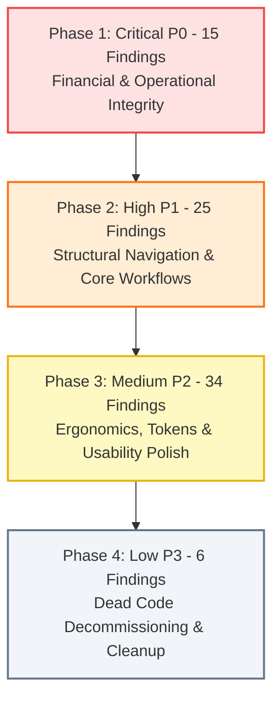

# Prioritized ERP UI/UX Remediation Roadmap

**Document ID:** `AUDIT-09-ROADMAP`  
**Application:** DNS Import & Export ERP (Client Frontend)  
**Scope:** Actionable Implementation Plan for 80 System-Wide Findings  
**Date:** October 2026  

---

## 1. Executive Summary & Phasing Strategy

This remediation roadmap translates the 80 findings identified during the system-wide audit into a disciplined, 4-phase engineering execution plan.

Remediation is prioritized strictly by **business risk, financial exposure, regulatory compliance, and workflow continuity**:

- **Phase 1: Critical (P0) — 15 Findings:** Eliminates multi-currency financial corruption, connects severed warehouse-to-finance data pipelines, repairs broken navigation links that kick approvers to the homepage, and resolves stock-count drift.
- **Phase 2: High (P1) — 25 Findings:** Eliminates component duplication (competing thermal receipt modals, duplicate approval dialogs), restores the orphaned damaged stock route, replaces unsearchable native select dropdowns, and eliminates dangerous auto-selection on payment forms.
- **Phase 3: Medium (P2) — 34 Findings:** Standardizes currency formatting (`Rs.` vs `LKR`), resolves WCAG 2.1 AA accessibility contrast defects, fixes duplicate stacked territory selectors, and removes leaked database schema names.
- **Phase 4: Low (P3) & Maintenance — 6 Findings:** Decommissions 1,850+ lines of dead legacy components (`FinanceDeskPage`, `PaymentApprovalPage`, `FinancePricingModal`), cleans redundant breadcrumbs, and polishes styling.

---

## 2. Phase 1: Critical (P0) — Financial, Operational & Governance Fixes

*Objective:* Prevent financial loss, correct skewed corporate reporting, and unblock cross-module document handoffs.

### Remediation Batch 1.1: Multi-Currency & FX Financial Governance
- **Finding IDs:** `PUR-010`, `PUR-011`, `FIN-002`
- **Affected Files:**
  - `src/features/purchasing/PurchasingDashboard.tsx`
  - `src/features/purchasing/PurchasingReportsPage.tsx`
  - `src/features/purchasing/PurchaseOrderCreateEditPage.tsx`
  - `src/features/finance/pages/ap/VendorBillCostingPage.tsx`
  - `src/services/PurchaseOrderService.ts`
- **Remediation Steps:**
  1. In `PurchasingDashboard` and `PurchasingReportsPage`, convert all foreign currency PO amounts (USD, EUR, CNY) to base LKR using `exchangeRate` before summing into Total Spend.
  2. In `PurchaseOrderCreateEditPage` and `PurchaseOrderService.ts`, evaluate the Director approval threshold of Rs. 500,000 using the computed base LKR total (`grandTotal * exchangeRate > 500000`), rather than the nominal foreign amount.
  3. In `VendorBillCostingPage.tsx`, introduce Foreign Currency and Customs/Spot Exchange Rate fields in Step 1. Apportion landed freight, customs duty, and port charges against base LKR converted totals.
- **Business Rules & Constraints:**
  - Mandatory dual-currency display (Foreign Total + Base LKR Equivalent).
  - Exchange rates must be positive numbers (`> 0`).
- **Risk / Complexity:** High (affects corporate spend reporting and margin calculations).

### Remediation Batch 1.2: Warehouse Receiving & Landed Cost Pipeline Synchronization
- **Finding IDs:** `INV-002`, `INV-003`, `INV-004`, `FIN-001`
- **Affected Files:**
  - `src/features/inventory/GRNCreateEditPage.tsx`
  - `src/features/inventory/InventoryDashboardPage.tsx`
  - `src/features/finance/pages/ap/VendorBillCostingPage.tsx`
  - `src/features/finance/services/apService.ts`
  - `src/services/GRNService.ts`
- **Remediation Steps:**
  1. In `GRNCreateEditPage.tsx`, replace `MOCK_PURCHASE_ORDERS` with live purchase orders fetched from `purchaseOrderService.getAll()`. Filter for approved POs.
  2. In `GRNCreateEditPage.tsx`, replace the static 4-supplier array with the live supplier master from `SupplierService`.
  3. In `InventoryDashboardPage.tsx`, delete the hardcoded `isPowerToolItem()` string filter (`['bosch', 'makita', 'dewalt']`) that hides electrical and wiring stock from the dashboard.
  4. In `apService.ts`, refactor `getAvailableGRNs()` to query `grnRepository.getAll()`, so real goods receipts submitted in `/inventory/grn/new` appear in Finance Landed Costing.
- **Business Rules & Constraints:**
  - Warehouse storekeepers cannot receive goods without an approved PO or valid active supplier.
  - Completed GRNs must update physical inventory stock balances.
- **Risk / Complexity:** High (core inventory and AP data pipeline).

### Remediation Batch 1.3: Approval Deep-Link Repairs & Governance Dead-Ends
- **Finding IDs:** `APR-001`, `APR-002`, `APR-003`, `APR-004`
- **Affected Files:**
  - `src/features/approvals/ApprovalsPage.tsx`
  - `src/features/customers/CustomerDetailPage.tsx`
  - `src/features/products/ProductListPage.tsx`
  - `src/features/inventory/GRNDetailPage.tsx`
- **Remediation Steps:**
  1. In `ApprovalsPage.tsx:49`, fix the payment receipt link: change `/finance/ar/receipt-approvals` to `/finance/ar/approvals`.
  2. In `CustomerDetailPage.tsx`, mount `CustomerCommercialApprovalModal` and render an approval action card when `approvalStage !== 'APPROVED'`.
  3. In `ApprovalsPage.tsx:54`, update the price change link: change `/inventory` to `/products/${app.documentId}`.
  4. In `ApprovalsPage.tsx:52`, update the GRN receipt link: change `/finance/ap/bills/new?grnId=...` to `/inventory/grn/${app.documentId}`.
- **Risk / Complexity:** Low / Immediate (prevents users being dropped onto `/` or wrong modules).

### Remediation Batch 1.4: Sub-Ledger Physical Stock & Invoice Reconciliation
- **Finding IDs:** `FIN-003`, `FIN-004`, `REP-001`, `REP-002`
- **Affected Files:**
  - `src/features/finance/services/customerCreditNoteService.ts`
  - `src/features/finance/services/arService.ts`
  - `src/features/reports/FinanceCollectionsTab.tsx`
  - `src/services/ReportService.ts`
- **Remediation Steps:**
  1. In `customerCreditNoteService.ts`, when `returnToStock` is true, call `inventoryService.recordStockMovement('RETURN_INWARD')` to increment physical stock balances in the destination warehouse.
  2. In `arService.ts`, replace `MOCK_OPEN_INVOICES` with live invoices from `InvoiceService`.
  3. In `ReportService.ts`, bind accounts receivable aging and collection metrics to the unified customer ledger.
- **Risk / Complexity:** High (requires multi-ledger consistency).

---

## 3. Phase 2: High (P1) — Structural, Workflow & Component Consolidation

*Objective:* Eliminate component duplication, restore orphaned routes, and fix hazardous form UX patterns.

### Remediation Batch 2.1: Orphaned Route Restoration & Navigation Polish
- **Finding IDs:** `INV-001`, `SAL-002`, `FIN-008`, `REP-005`
- **Affected Files:**
  - `src/App.tsx`
  - `src/components/common/Sidebar.tsx`
  - `src/features/inventory/DamagedStockPage.tsx`
  - `src/features/payments/PaymentListPage.tsx`
  - `src/features/purchasing/PurchasingSuppliersPage.tsx`
  - `src/features/finance/pages/SuppliersPage.tsx`
  - `src/features/reports/ReportsPage.tsx`
- **Remediation Steps:**
  1. Register `<Route path="inventory/damaged-stock" element={<DamagedStockPage />} />` in `App.tsx` to unblock the sidebar link.
  2. Expose the 1,360-line `PaymentListPage.tsx` (`/payments`) under the Sales & Customers navigation menu in `Sidebar.tsx`.
  3. Consolidate `/purchasing/suppliers` and `/finance/suppliers` into a unified `SupplierHubPage`.
  4. Add a `Procurement Analytics` tab to `/reports` linking to purchasing data.

### Remediation Batch 2.2: Eradication of Dangerous Auto-Selection & Form Pickers
- **Finding IDs:** `FIN-006`, `FIN-007`, `PUR-006`
- **Affected Files:**
  - `src/features/finance/pages/ap/SupplierAdvancePaymentsPage.tsx`
  - `src/features/finance/pages/ap/SupplierDebitNotesPage.tsx`
  - `src/features/finance/pages/ap/BatchSupplierPaymentPage.tsx`
  - `src/features/finance/pages/ar/CustomerCreditNotesPage.tsx`
  - `src/features/purchasing/PurchaseOrderCreateEditPage.tsx`
- **Remediation Steps:**
  1. Remove `useEffect` hooks auto-selecting `suppliers[0].id` on payment and advance forms. Initialize `selectedSupplierId = ""` and mandate user selection.
  2. Replace native HTML `<select>` elements mapping `MOCK_PRODUCTS` with `ProductSelectorModal` / combobox.
  3. Replace raw supplier and customer selects with `SupplierSelector` and `CustomerSelector`.

### Remediation Batch 2.3: Component Duplication Elimination
- **Finding IDs:** `SAL-001`, `APR-005`, `APR-006`, `INV-005`
- **Affected Files:**
  - `src/features/pos/ThermalReceiptModal.tsx`
  - `src/features/payments/ThermalReceiptModal.tsx`
  - `src/features/approvals/ApprovalsPage.tsx`
  - `src/features/orders/OrderDetailPage.tsx`
  - `src/features/inventory/DispatchPage.tsx`
- **Remediation Steps:**
  1. Decommission the unstyled POS `ThermalReceiptModal.tsx`. Standardize on the Radix-backed `features/payments/ThermalReceiptModal.tsx` across POS and payments.
  2. In `ApprovalsPage.tsx`, add category tabs for `Purchase Orders` and `Price Proposals`.
  3. In `OrderDetailPage.tsx`, replace the custom inline dialog with `ApprovalActionDialog.tsx`.
  4. In `DispatchPage.tsx`, replace the legacy delivery note modal with the canonical `delivery-notes/` sub-module.

### Remediation Batch 2.4: Analytical Performance & Reporting Integrity
- **Finding IDs:** `REP-003`, `REP-006`, `REP-007`, `APR-007`, `APR-008`
- **Affected Files:**
  - `src/hooks/useReports.ts`
  - `src/features/reports/ReportsFilterToolbar.tsx`
  - `src/features/reports/CommissionAnalyticsTab.tsx`
  - `src/features/reports/PosAnalyticsTab.tsx`
  - `src/features/approvals/OrderApprovalDetailPage.tsx`
  - `src/types/approval.ts`
  - `src/features/finance/pages/journal/ManualJournalPage.tsx`
- **Remediation Steps:**
  1. Refactor `useReports.ts` to fetch analytical queries lazily per active tab instead of firing 20 parallel queries on mount.
  2. Implement proper print layout styles in `ReportsFilterToolbar.tsx`.
  3. Define strict TypeScript interfaces for `CommissionAnalyticsTab` and `PosAnalyticsTab`.
  4. Mount an Exception Notice Banner on `OrderApprovalDetailPage.tsx` displaying the exact policy breached.
  5. Add `JOURNAL_ENTRY` to `ApprovalDocumentType` and link manual journal vouchers into the central queue.

---

## 4. Phase 3: Medium (P2) — Usability, Ergonomics & Design Tokens

*Objective:* Polish visual hierarchy, resolve WCAG accessibility contrast failures, and unify styling conventions.

### Remediation Batch 3.1: Currency Display & Format Standardization
- **Finding IDs:** `REP-004`, `PUR-004`, `SAL-007`
- **Affected Files:**
  - `src/utils/formatters.ts`
  - `src/utils/exportUtils.ts`
  - All tabs in `src/features/reports/`
- **Remediation Steps:**
  1. Deprecate `formatCurrencyLKR()` in `exportUtils.ts`.
  2. Standardize all 47 routes on `formatCurrency()` (`Rs. #,##0.00` with `tabular-nums`).

### Remediation Batch 3.2: Accessibility & Visual Contrast Repairs
- **Finding IDs:** `APR-010`, `APR-011`, `SAL-006`
- **Affected Files:**
  - `src/components/approval/ApprovalTimeline.tsx`
  - `src/components/approval/ApprovalActionDialog.tsx`
- **Remediation Steps:**
  1. In `ApprovalTimeline.tsx`, fix white icons on light backgrounds: use `text-primary` on `bg-primary-light`, or switch to solid `bg-primary` with `text-white` to achieve WCAG 2.1 AA 3:1 contrast.
  2. In `ApprovalActionDialog.tsx`, style the "Confirm APPROVE" button with emerald green (`bg-emerald-600`) to match system semantics.

### Remediation Batch 3.3: Filter & Selector Ergonomic Alignment
- **Finding IDs:** `REP-008`, `REP-009`, `REP-010`, `REP-011`, `REP-012`, `FIN-013`, `FIN-014`
- **Affected Files:**
  - `src/features/reports/AreaPerformanceTab.tsx`
  - `src/features/reports/ReportsFilterToolbar.tsx`
  - `src/features/reports/ReportsPage.tsx`
  - `src/features/finance/pages/reports/ReportDateFilterBar.tsx`
  - `src/features/finance/pages/reports/VatSummaryPage.tsx`
- **Remediation Steps:**
  1. Remove duplicate "Switch Territory" selector from `AreaPerformanceTab.tsx`.
  2. Unify `ReportsFilterToolbar` and `ReportDateFilterBar` with quick preset buttons (`Today`, `Month`, `Quarter`, `Year`).
  3. Assign semantically distinct Lucide icons to `ReportsPage` navigation tabs (`Store` for POS, `Award` for Commission).
  4. Replace hardcoded `"18% VAT Summary"` tab labels with dynamic tax rate references.
  5. Compute default report date filters dynamically using the current calendar month.

### Remediation Batch 3.4: Copywriting & Production Readiness
- **Finding IDs:** `FIN-011`, `FIN-012`, `FIN-015`, `PUR-012`, `PUR-013`, `SAL-010`, `SAL-011`, `INV-007`
- **Affected Files:**
  - `src/features/finance/components/CorporateReportHeader.tsx`
  - `src/features/finance/components/CorporateSignatureBlock.tsx`
  - `src/features/finance/pages/reports/MonthlyTransactionsAuditPage.tsx`
  - `src/features/finance/pages/FinanceDashboardPage.tsx`
- **Remediation Steps:**
  1. Replace hardcoded company registration details and signatory names with dynamic organization settings. Remove fake cursive signatures.
  2. Replace technical database table names (`journal_entries (INSERT)`) with business accounting terms (`Master Journal Voucher Created`).
  3. Remove developer milestone badges (`Phase 1 Executive Master`) from production page headers.

---

## 5. Phase 4: Low (P3) & Maintenance — Dead Code Cleanup

*Objective:* Remove obsolete code, eliminate redundant wrappers, and minimize bundle size.

### Remediation Batch 4.1: Decommissioning Dead Legacy Code (1,850+ lines)
- **Finding IDs:** `FIN-005`, `APR-014`, `FIN-016`, `REP-013`
- **Affected Files:**
  - `src/App.tsx` (remove dead imports and redirects for `desk` and `payment-approvals`)
  - `src/features/finance/pages/FinanceDeskPage.tsx` (delete 622 lines)
  - `src/features/finance/pages/PaymentApprovalPage.tsx` (delete 650 lines)
  - `src/features/finance/components/DebitCreditRow.tsx` (delete 215 lines)
  - `src/features/finance/components/BalancingBar.tsx` (delete 150 lines)
  - `src/features/finance/components/FinancePricingModal.tsx` (delete 380 lines)
  - `src/features/finance/FinanceLayout.tsx` (standardize on `StandardLayout.tsx`)
- **Remediation Steps:**
  1. Safely remove dead legacy files and their unused imports from `App.tsx`.
  2. Update unit tests that import `FinanceDeskPage` or `PaymentApprovalPage` to test the active production pages (`ManualJournalPage` and `ReceiptApprovalQueuePage`).
  3. Remove redundant header breadcrumbs in `OrderApprovalDetailPage.tsx`.

---

## 6. Implementation Schedule & Verification Matrix

| Phase | Finding Count | Estimated Effort | Primary Dependencies | Verification Method |
| :---: | :---: | :---: | :--- | :--- |
| **Phase 1 (P0)** | 15 | 2–3 Days | `OrderService`, `PurchaseOrderService`, `GRNService`, `apService`, `arService` | Currency conversion unit tests; live GRN-to-Bill end-to-end flow test. |
| **Phase 2 (P1)** | 25 | 3–4 Days | Phase 1 completion; `ProductSelectorModal`, `ThermalReceiptModal` | Navigation test across all 47 routes; entity selector combobox tests. |
| **Phase 3 (P2)** | 34 | 2–3 Days | Phase 2 completion; design tokens | Automated WCAG contrast audit; visual regression check on tables and badges. |
| **Phase 4 (P3)** | 6 | 1 Day | Phase 3 completion | Build bundle size verification (`vite build`); TypeScript strict type check. |
| **TOTAL** | **80** | **8–11 Days** | Full application test suite passing | 100% route verification without runtime console errors. |
