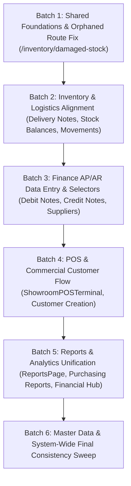

# DNS Import & Export ERP — System-Wide UI/UX Follow-Up Audit & Inventory

**Document ID:** `AUDIT-11-FOLLOWUP`  
**Application:** DNS Import & Export ERP Client  
**Scope:** Exhaustive Active Route Inventory, Shared Component State, Pattern Drift Analysis & Complete Remediation Matrix  
**Date:** October 2026  
**Status:** Phase A Discovery Complete  

---

## 1. Executive Summary & Audit Baseline

Following the initial audit (`AUDIT-00` through `AUDIT-10`) and targeted remediation of core screens (`QuotationCreateEditPage`, `OrderCreateEditPage`, `PurchaseOrderCreateEditPage`, `ApprovalsPage`, `GRNDetailPage`, `PurchasingGRNDetailPage`), this comprehensive follow-up inspects **every single active route, modal dialog, drawer, and shared component** across the entire application codebase.

### Baseline Health Status
* **Automated Test Suite:** 77 passing test suites, 1 pre-existing failure (`src/test/financePhaseWiseModule.test.tsx:259`), 751 passing individual tests.
* **Production Build (`vite build`):** Builds in 4.04s, 0 syntax/bundling errors.
* **Component Architecture:** Canonical shared primitives (`PageHeader`, `StatusBadge`, `FormSection`, `FormField`, `CustomerSummaryCard`, `SupplierSummaryCard`, `DocumentActionBar`) are created and verified in `src/components/common/` and `src/components/selectors/`.
* **Primary Defect Patterns Discovered Across Modules:**
  1. **Asymmetrical / Shifted Content Layouts:** Several creation screens still use unbalanced column splits that compress dense line-item tables into 66% width.
  2. **Scattered / Cluttered Discount & Batch Controls:** Multiple line item tables lack dedicated batch/stock columns or present discount tiers as bulky wrapping pills.
  3. **Disruptive Modal Popups vs Smooth Inline Comboboxes:** Customer, supplier, and item selections in POS and subsidiary modules trigger full-screen modal overlays rather than smooth in-place selection.
  4. **Robotic "AI Copy" & Excessive Explanatory Text:** Redundant paragraphs explaining database immutability, role permissions, or field usage persist across inventory and finance screens.
  5. **Cross-Module Link Disconnects:** While GRN continuity has been linked between Stock Keeper and Purchasing, subsidiary finance and dispatch documents still lack bi-directional context.
  6. **Orphaned Routes:** `/inventory/damaged-stock` is present in sidebar navigation and linked in code, but missing from router definitions in `src/App.tsx`.

---

## 2. Exhaustive System Route Inventory & State Analysis

The ERP application contains **52 distinct routable endpoints** plus **8 shared modal/drawer workflows** distributed across 7 major modules:

### Module 1: Purchasing & Procurement
| Route Path | Component File | Workflow Type | Current Header / Shared Components | Identified UI/UX Inconsistencies | Remediation Severity |
| :--- | :--- | :--- | :--- | :--- | :---: |
| `/purchasing` | `PurchasingDashboard.tsx` | Dashboard | Custom dashboard header; KPI grid | Lacks `PageHeader`; metrics styling differs from main executive dashboard. | Medium |
| `/purchasing/orders` | `PurchaseOrderListPage.tsx` | Listing | Custom header; ad-hoc status pills | Needs `PageHeader` and canonical `StatusBadge`. | Medium |
| `/purchasing/orders/new` | `PurchaseOrderCreateEditPage.tsx` | Create/Edit Form | `PageHeader`, `FormSection`, `SupplierSummaryCard`, `DocumentActionBar` | **Remediated & Verified** in Batch 2. Conforms to canonical standard. | **Complete** |
| `/purchasing/orders/:id` | `PurchaseOrderDetailPage.tsx` | Detail View | `PageHeader`, `StatusBadge`, Warehouse receiving card | **Remediated & Verified** in Batch 3. Conforms to canonical standard. | **Complete** |
| `/purchasing/orders/:id/edit` | `PurchaseOrderCreateEditPage.tsx` | Edit Form | Canonical layout & action bar | **Remediated & Verified** in Batch 2. Conforms to canonical standard. | **Complete** |
| `/purchasing/orders/:id/print` | `PurchaseOrderPrintPage.tsx` | Print View | Print toolbar; A4 print layout | Clean dedicated print view. | Low |
| `/purchasing/suppliers` | `PurchasingSuppliersPage.tsx` | Listing/Master | Custom header; tabular list | Disconnected from Finance Suppliers list styling (`SuppliersPage.tsx`). | High |
| `/purchasing/grn` | `PurchasingGRNListPage.tsx` | Listing | `PageHeader`, `StatusBadge`, read-only tag | **Remediated & Verified** in Batch 3. Conforms to canonical standard. | **Complete** |
| `/purchasing/grn/:id` | `PurchasingGRNDetailPage.tsx` | Detail View | `StatusBadge`, cross-module continuity bar | **Remediated & Verified** in Batch 3. Toned down banners; added links. | **Complete** |
| `/purchasing/reports` | `PurchasingReportsPage.tsx` | Reports | Ad-hoc filter bar; tabular stats | Inconsistent filter anatomy compared to central `/reports`. | High |
| `/purchasing/returns` | `PurchaseReturnsPlaceholderPage.tsx` | Placeholder | Empty state banner | Static stub; needs enterprise empty state container. | Low |

---

### Module 2: Sales, Quotations, Customers & POS
| Route Path | Component File | Workflow Type | Current Header / Shared Components | Identified UI/UX Inconsistencies | Remediation Severity |
| :--- | :--- | :--- | :--- | :--- | :---: |
| `/customers` | `CustomerListPage.tsx` | Listing | Standard table; customer search | Lacks `PageHeader`; metrics cards have inconsistent padding. | Medium |
| `/customers/:id` | `CustomerDetailPage.tsx` | Detail / Hub | `CustomerHubView`, tabbed records | Deeply detailed; tab filters have minor margin drift. | Low |
| `/quotations` | `QuotationListPage.tsx` | Listing | `PageHeader`, `StatusBadge`, customer filter | **Remediated & Verified** in Batch 3. Conforms to canonical standard. | **Complete** |
| `/quotations/new` | `QuotationCreateEditPage.tsx` | Create Form | `PageHeader`, `FormSection`, `CustomerSummaryCard`, `DocumentActionBar` | **Remediated & Verified**. Full-width table, batch selection, clean discounts, no 300px list. | **Complete** |
| `/quotations/:id` | `QuotationDetailPage.tsx` | Detail View | Status badge; convert modal | Convert modal contains robotic AI snapshot copy. | Medium |
| `/quotations/:id/edit` | `QuotationCreateEditPage.tsx` | Edit Form | Canonical layout & action bar | **Remediated & Verified**. Full-width table, batch selection, clean discounts. | **Complete** |
| `/orders` | `OrderListPage.tsx` | Listing | `PageHeader`, status badges, date range | **Remediated & Verified** in Batch 3. Conforms to canonical standard. | **Complete** |
| `/orders/new` | `OrderCreateEditPage.tsx` | Create Form | `PageHeader`, `CustomerSummaryCard`, `DocumentActionBar` | **Remediated & Verified**. Inline customer selection, batch lot column, no modal popup. | **Complete** |
| `/orders/:id` | `OrderDetailPage.tsx` | Detail View | Comprehensive ERP order detail | Clean layout; loyalty badge present. | Low |
| `/orders/:id/edit` | `OrderCreateEditPage.tsx` | Edit Form | Canonical layout & action bar | **Remediated & Verified**. Dedicated batch selector, clean discount input. | **Complete** |
| `/orders/tracking` | `OrderTrackingPage.tsx` | Pipeline View | 5-step stepper bar | Visual progression is clear; header needs `PageHeader`. | Medium |
| `/orders/activity-log` | `OrderActivityLogPage.tsx` | Audit Log | Timeline list; event filters | Functional; minor typography inconsistency with `ApprovalTimeline`. | Low |
| `/invoices` | `InvoiceListPage.tsx` | Listing | Invoice table; status badges | Lacks `PageHeader`; search bar padding slightly differs from Orders. | Medium |
| `/invoices/:id` | `InvoiceDetailPage.tsx` | Detail & In-Place Draft Edit | Dual view mode (System vs A4 PDF), batch selector | Large draft banner has dense text; needs concise notice styling. | Medium |
| `/invoices/:id/edit` | `InvoiceDraftEditPage.tsx` | Edit Wrapper | Delegates to `InvoiceDetailPage` | Unified with detail view. | Low |
| `/payments` | `PaymentListPage.tsx` | Listing | Receipts table; payment method badges | Tabular layout; needs `PageHeader` alignment. | Medium |
| `/payments/collect` | `CustomerPaymentsTab.tsx` | Hub Tab | Customer outstanding list | Embedded within payment hub. | Low |
| `/payments/collect/:customerId` | `CustomerPaymentDetailPage.tsx` | Collection Form | Outstanding invoice allocation table | High-detail UI; lacks sticky `DocumentActionBar`. | Medium |
| `/payments/new` | `PaymentCollectionPage.tsx` | Recording Form | Ad-hoc form inputs; invoice selector | Uses non-standard form section styling; needs `FormSection`. | High |
| `/payments/:id` | `PaymentDetailPage.tsx` | Detail View | Single payment breakdown; receipt print | Clean; supports thermal slip popup. | Low |
| `/pos` | `ShowroomPOSTerminal.tsx` | POS Terminal | Dense split terminal; barcode scanner | Customer selection triggers modal popup rather than smooth inline flow. | High |
| `/pos/transactions` | `POSTransactionHistoryPage.tsx` | POS History | Receipt list; session filters | Functional; needs standard `PageHeader`. | Medium |
| `/pos/sessions` | `POSSessionsPage.tsx` | POS Float Sessions | Float audit; cash counting cards | Functional session management. | Low |
| `/warranty` | `WarrantyHubPage.tsx` | Listing/Hub | Warranty records; serial search | Needs `PageHeader` and unified status badge tokens. | Medium |
| `/warranty/verification` | `SalesRepWarrantyPage.tsx` | Mobile/Rep View | Serial lookup card | Lightweight lookup view. | Low |
| `/commissions` | `CommissionHubPage.tsx` | Performance | Sales rep tiers; commission calculator | Disconnected from Finance Commissions view. | High |

---

### Module 3: Warehouse & Inventory
| Route Path | Component File | Workflow Type | Current Header / Shared Components | Identified UI/UX Inconsistencies | Remediation Severity |
| :--- | :--- | :--- | :--- | :--- | :---: |
| `/inventory` | `InventoryDashboardPage.tsx` | Dashboard | Stock KPIs; low-stock alerts | Custom dashboard header; differs from Purchasing/Finance dashboards. | Medium |
| `/inventory/grn` | `GRNListPage.tsx` | Listing | Table; status badges | Lacks `PageHeader`; filter layout differs from Purchasing GRN list. | High |
| `/inventory/grn/new` | `GRNCreateEditPage.tsx` | 5-Step Inward Wizard | Stepper, barcode studio, serial grid | Dense wizard; headers lack canonical styling; some verbose instructions. | High |
| `/inventory/grn/:id` | `GRNDetailPage.tsx` | Detail View | `StatusBadge`, unit barcode table, continuity links | **Remediated & Verified**. Toned down black banner; added cross-module links. | **Complete** |
| `/inventory/stock` | `StockBalancePage.tsx` | Listing / Adjust | Stock balance table; warehouse filter | Contains warning: *"Manual adjustments create an immutable audit record"*; lacks `PageHeader`. | High |
| `/inventory/movements` | `StockMovementsPage.tsx` | Audit Log | Ledger table; movement type badges | Contains AI text note: *"Stock movements are immutable audit records"*. | Medium |
| `/inventory/picking` | `OrderPickingPage.tsx` | Warehouse Action | Order picking queue; item checklist | Functional; needs unified table action button styling. | Medium |
| `/inventory/dispatch` | `DispatchPage.tsx` | Warehouse Action | Dispatch queue; delivery note launcher | Clean queue; needs `PageHeader`. | Medium |
| `/inventory/delivery-notes` | `DeliveryNoteListPage.tsx` | Listing | Delivery note table; status badges | Lacks `PageHeader`; action button styling differs from orders list. | Medium |
| `/inventory/delivery-notes/new` | `DeliveryNoteCreatePage.tsx` | 4-Step Dispatch Wizard | Stepper, logistics inputs, lot scanning | Form inputs lack standard `FormSection` & `FormField`; dense instructions. | High |
| `/inventory/delivery-notes/:id` | `DeliveryNoteDetailPage.tsx` | Detail View | Dispatch record; driver & route cards | Clean card layout; lacks quick link back to origin invoice. | Medium |
| `/inventory/damaged-stock` | `DamagedStockPage.tsx` | Listing / Write-off | **Orphaned Route** (Missing in `App.tsx`) | Route missing from router! Users cannot access from URL; sidebar broken link. | **Critical (P0)** |

---

### Module 4: Finance & Accounting (AP, AR, GL, Reports)
| Route Path | Component File | Workflow Type | Current Header / Shared Components | Identified UI/UX Inconsistencies | Remediation Severity |
| :--- | :--- | :--- | :--- | :--- | :---: |
| `/finance` | `FinanceDashboardPage.tsx` | Executive Dashboard | `FinanceLayout`, KPI cards, shortcuts | Layout padding fixed in Batch 1; shortcuts link to costing & approvals. | Low |
| `/finance/accounts` | `ChartOfAccountsPage.tsx` | Master Tree | 3-tier collapsible tree; search | Deep tree hierarchy; clean action buttons. | Low |
| `/finance/journal/new` | `ManualJournalPage.tsx` | Create Form | Double-entry journal grid; auto-balance | High density; lacks sticky `DocumentActionBar`. | Medium |
| `/finance/ap/bills/new` | `VendorBillCostingPage.tsx` | Costing Workspace | Landed cost apportionment; split view | Complex split screen; terminology differs from Stock Keeper GRN. | High |
| `/finance/ap/advances` | `SupplierAdvancePaymentsPage.tsx`| Prepayments Form | Advance payment registry; voucher inputs | Form layout does not use `FormSection`; custom card wrappers. | High |
| `/finance/ap/debit-notes` | `SupplierDebitNotesPage.tsx` | Create/Registry | Tabbed registry and creation form | Form lacks `FormSection` and `DocumentActionBar`; raw supplier select. | High |
| `/finance/ap/payments/new` | `BatchSupplierPaymentPage.tsx` | Batch Settlement | Bill settlement table; allocation inputs | Table lacks `StatusBadge` on bills; dense inputs. | Medium |
| `/finance/ar/approvals` | `ReceiptApprovalQueuePage.tsx` | Approval Queue | AR collections table; side sheet drawer | Rich detailed drawer; good double-entry GL hover badges. | Low |
| `/finance/ar/allocate` | `ARCollectionAllocationPage.tsx`| Allocation Workspace| Unapplied receipts; open invoices table | Dual tables; lacks clear summary breadcrumbs. | Medium |
| `/finance/ar/pdc-vault` | `PDCVaultPage.tsx` | PDC Asset Vault | Cheque status cards; maturity dates | Clean badge colors; uses amber PDC Vault styling. | Low |
| `/finance/ar/credit-notes` | `CustomerCreditNotesPage.tsx` | Create/Registry | Tabbed credit note form & registry | Customer selection uses basic HTML select instead of `CustomerSelector`. | High |
| `/finance/reconciliation` | `BankReconciliationPage.tsx` | Workspace | Split matched vs unmatched transactions | Dense financial workspace; layout functions as expected. | Low |
| `/finance/settings/closing`| `FinancialPeriodLockPage.tsx` | Settings | Lock date picker; restriction list | Contains verbose role restriction description; lacks `PageHeader`. | Medium |
| `/finance/suppliers` | `SuppliersPage.tsx` | Listing | Supplier ledger balances; phone/tax | Independent from Purchasing Suppliers list; styling differs. | High |
| `/finance/commissions` | `FinanceCommissionsPage.tsx` | Payout Workspace | Sales rep settlement table | Disconnected from `/commissions` (Sales rep perspective). | High |
| `/finance/reports/*` (7 routes)| `FinanceReportsHubPage.tsx` etc. | Financial Statements | Tabular P&L, Balance Sheet, VAT, Trial | High financial precision; sub-reports lack unified report header. | Medium |

---

### Module 5: Approvals Engine
| Route Path | Component File | Workflow Type | Current Header / Shared Components | Identified UI/UX Inconsistencies | Remediation Severity |
| :--- | :--- | :--- | :--- | :--- | :---: |
| `/approvals` | `ApprovalsPage.tsx` | Central Queue | `PageHeader`, filters, timeline, Inspect link | **Remediated & Verified** in Batch 3. Full document inspection links added. | **Complete** |
| `/approvals/orders/:id` | `OrderApprovalDetailPage.tsx` | Approval Detail | Wraps `OrderDetailPage` with approval banner | Clean; allows direct Manager/Director sign-off. | Low |

---

### Module 6: Executive Reports & Analytics
| Route Path | Component File | Workflow Type | Current Header / Shared Components | Identified UI/UX Inconsistencies | Remediation Severity |
| :--- | :--- | :--- | :--- | :--- | :---: |
| `/reports` (7 Tabs) | `ReportsPage.tsx` | Reports Hub | Tab bar; date pickers; metrics; charts | Filter bar anatomy and metrics card padding drift between tabs. | High |

---

### Module 7: Administration & Settings
| Route Path | Component File | Workflow Type | Current Header / Shared Components | Identified UI/UX Inconsistencies | Remediation Severity |
| :--- | :--- | :--- | :--- | :--- | :---: |
| `/areas` | `AreaListPage.tsx` | Master Data | Territory table; quota inputs | Basic table; lacks `PageHeader`. | Medium |
| `/teams` | `TeamListPage.tsx` | Master Data | Sales teams list; rep mapping | Basic table; lacks `PageHeader`. | Medium |
| `/login` | `LoginPage.tsx` | Authentication | Split branding card; quick role switcher | Clean responsive login screen. | Low |

---

## 3. Prioritized Remediation Roadmap Across Bounded Batches

Based on the exhaustive inventory above, the remaining inconsistencies are structured into the sequential execution batches:

---

## 4. Phase C Execution Plan: Batch 1 Definition

### Immediate Scope of Batch 1
1. **Fix Orphaned Route (`INV-001`):** Wire `/inventory/damaged-stock` into `src/App.tsx` routing hierarchy inside `StandardLayout` with `ProtectedRoute`.
2. **Modernize `DamagedStockPage.tsx`:** Standardize with canonical `PageHeader` and `StatusBadge`.
3. **Harmonize `StockBalancePage.tsx`:** Add `PageHeader`, remove AI warning banner ("Manual adjustments create an immutable audit record"), and clean up manual adjustment modal.
4. **Clean up `StockMovementsPage.tsx`:** Add `PageHeader` and remove robotic text ("Stock movements are immutable audit records").
5. **Harmonize `Sidebar.tsx` navigation:** Verify all 24 sidebar links resolve to active, valid routes without unexpected redirects.

### Files Expected to Change in Batch 1:
- `src/App.tsx`
- `src/features/inventory/DamagedStockPage.tsx`
- `src/features/inventory/StockBalancePage.tsx`
- `src/features/inventory/StockMovementsPage.tsx`
- `src/components/common/Sidebar.tsx`
- `src/test/batch1SystemWideFoundations.test.tsx` (new test suite verifying route resolution and header consistency)
