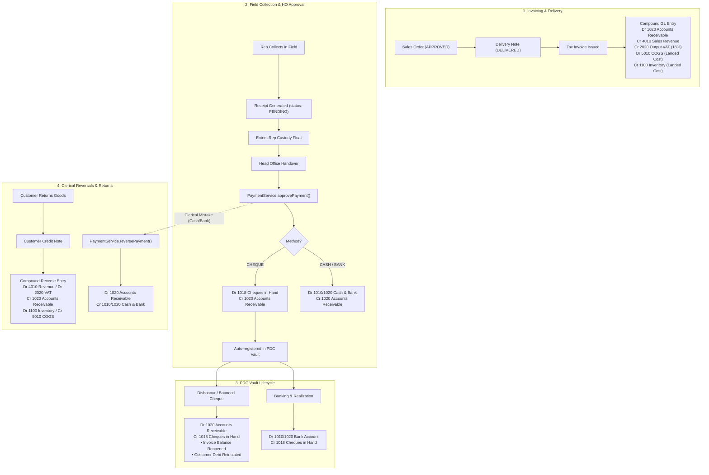

# Sales Module Finance & Post-Sales Integration Architecture

## 1. Executive Summary & Core Principles

This document provides complete technical and operational documentation of the **Sales Module Finance and Post-Sales Integration** developed for the DNS ERP system.

The implementation unifies operational sales actions (Order Fulfillment, Delivery-based Invoicing, Field Collections, Cheque Management, and Returns) with the **Finance Double-Entry General Ledger**.

### Core Accounting & Business Rules:
1. **Single Currency (LKR)**: All invoicing, collections, taxes, and ledger lines are denominated strictly in Sri Lankan Rupees (LKR). Currency translation and FX gain/loss complexities are excluded.
2. **Perpetual Inventory & Landed COGS**: Invoicing goods relieved from stock does not use arbitrary catalogue costs. It recognizes Cost of Goods Sold (COGS) using the **actual unit landed cost** established during the GRN Costing stage.
3. **Custody Float Separation**: Cash and cheques collected in the field remain in the Sales Representative's personal custody float (`PENDING_APPROVAL`). They only enter the company's ledger and reduce customer balances when verified and approved by Head Office Finance (`APPROVED`).
4. **Method-Based Ledger Branching**:
   - **Cash & Bank Transfer**: Liquid assets; debited directly into Cash in Hand (`GL 1010`) or Bank Account (`GL 1020`).
   - **Cheques (Current & Post-Dated)**: Debited into the **PDC Vault (`GL 1018 - Cheques in Hand`)**. Bank accounts are never touched until physical clearance.
5. **Decoupled Cheque Lifecycle**: Once a cheque enters the PDC Vault, all subsequent actions (bank banking, realization, or dishonour/bouncing) are owned by the `PDCVaultService`.

---

## 2. End-to-End Post-Sales Flow



---

## 3. General Ledger Double-Entry Posting Matrix

| Transaction | Trigger Method | Debit Account(s) | Credit Account(s) | Audit / Sub-Ledger Tags |
| :--- | :--- | :--- | :--- | :--- |
| **Sales Invoice Issuance** | `InvoiceService.createInvoiceFromOrder` | **`1020` Accounts Receivable** (Gross total)<br>**`5010` Cost of Goods Sold** (Landed cost) | **`4010` Sales Revenue** (Net of discounts)<br>**`2020` Output VAT Payable** (18% tax)<br>**`1100` Inventory - Good Stock** (Landed cost) | `customerId`, `customerName`, `invoiceNumber` |
| **Cash Collection Approved** | `PaymentService.approvePayment` (`CASH`) | **`1010` Cash in Hand** (or `1040` Safe Float) | **`1020` Accounts Receivable** | `customerId`, `customerName`, `receiptNumber` |
| **Bank Transfer Approved** | `PaymentService.approvePayment` (`BANK_TRANSFER`) | **`1020` Commercial Bank Account** | **`1020` Accounts Receivable** | `customerId`, `customerName`, `receiptNumber` |
| **Cheque Collection Approved** | `PaymentService.approvePayment` (`CHEQUE`) | **`1018` Cheques in Hand / PDC Vault** | **`1020` Accounts Receivable** | `customerId`, `customerName`, `receiptNumber`, `chequeNumber` |
| **Cheque Realized / Cleared** | `pdcVaultService.clearCheque` | **`1010/1020` Commercial Bank Account** | **`1018` Cheques in Hand / PDC Vault** | `chequeNumber`, `drawerBank`, `clearanceDate` |
| **Cheque Dishonoured / Bounced** | `pdcVaultService.bounceCheque` | **`1020` Accounts Receivable** (Debt reinstated) | **`1018` Cheques in Hand / PDC Vault** | `customerId`, `customerName`, `chequeNumber`, `bounceReason` |
| **Payment Clerical Reversal** | `PaymentService.reversePayment` (Cash/Bank) | **`1020` Accounts Receivable** (Re-opened) | **`1010/1020` Cash / Bank Account** | `customerId`, `customerName`, `receiptNumber`, `reversalReason` |
| **Customer Sales Return** | `customerCreditNoteService.createCreditNote` | **`4010` Sales Revenue** (Reversed)<br>**`2020` Output VAT** (Reversed)<br>**`1100` Inventory** (Restored) | **`1020` Accounts Receivable** (Debt relieved)<br>**`5010` Cost of Goods Sold** (Reversed) | `customerId`, `customerName`, `creditNoteNumber`, `reason` |

---

## 4. Schemas & Data Model Specifications

### 4.1. Payment Interface (`src/types/payment.ts`)
```typescript
export type PaymentStatus = 
  | 'PENDING_APPROVAL' 
  | 'APPROVED' 
  | 'REJECTED' 
  | 'BOUNCED' 
  | 'DISHONOURED'
  | 'REVERSED';

export type PaymentMethod = 'CASH' | 'CHEQUE' | 'BANK_TRANSFER';

export interface Payment extends BaseEntity {
  receiptNumber: string;                  // e.g. REC-2026-0001
  customerId: string;
  customerName: string;
  customerCode?: string;
  salesRepId: string;
  salesRepName: string;
  amount: number;
  paymentMethod: PaymentMethod;
  status: PaymentStatus;
  chequeNumber?: string;
  chequeDate?: string;
  bankName?: string;
  invoiceAllocations: PaymentAllocation[];
  notes?: string;
  collectedAt: string;
  approvedById?: string;
  approvedByName?: string;
  approvedAt?: string;
  journalEntryId?: string;               // General Ledger Capitalization Journal ID
  reversalJournalId?: string;            // GL Journal ID if payment was reversed
  reversedById?: string;
  reversedByName?: string;
  reversedAt?: string;
  reversalReason?: string;
}
```

### 4.2. Invoice Interface (`src/types/invoice.ts`)
```typescript
export interface Invoice {
  id: string;
  invoiceNumber: string;                 // e.g. INV-2026-1001
  orderId: string;
  orderNumber: string;
  customerId: string;
  customerName: string;
  items: InvoiceItem[];
  subtotal: number;
  discountTotal: number;
  taxTotal: number;
  totalAmount: number;
  paidAmount: number;
  balanceAmount: number;
  status: 'DRAFT' | 'ISSUED' | 'COLLECTED' | 'PARTIALLY_COLLECTED' | 'PAID' | 'PARTIALLY_PAID' | 'CANCELLED';
  journalEntryId?: string;               // Revenue & COGS recognition GL Journal ID
  totalCostAmount?: number;              // Total Landed Cost of goods sold (COGS)
}
```

### 4.3. PostDatedCheque Interface (`src/features/finance/api/types.ts`)
```typescript
export interface PostDatedCheque {
  id: string;
  chequeNumber: string;
  receiptId?: string;
  receiptNumber?: string;
  customerId: string;
  customerName: string;
  drawerBank: string;
  chequeDate: string;                    // Maturity date (YYYY-MM-DD)
  receivedDate: string;
  amount: number;
  status: 'IN_HAND' | 'CLEARED' | 'BOUNCED' | 'RETURNED' | 'VOIDED';
  holdingAccountCode: string;            // '1018'
  clearedAccountCode?: string;           // '1010'
  journalEntryId?: string;               // Initial intake GL entry (Dr 1018 / Cr 1020)
  clearanceJournalId?: string;           // Clearance GL entry (Dr 1010 / Cr 1018)
  bounceReason?: string;
}
```

---

## 5. Service Architectures & Key Logic

### 5.1. `PaymentService.ts`

#### A. `approvePayment(paymentId, currentUser, comment)`
1. **Permission Check**: Verifies actor has `FINANCE_MANAGER`, `DIRECTOR`, or `MANAGER` authority. Enforces separation of duties (sales rep cannot approve their own collection).
2. **Double-Entry Journal Creation**:
   - Dynamically resolves GL accounts (`1020 AR`, `1010/1040 Bank/Cash`, `1018 PDC Vault`).
   - If `CASH` or `BANK_TRANSFER`: Posts `Dr 1010/1040 / Cr 1020`.
   - If `CHEQUE`: Posts `Dr 1018 / Cr 1020`.
3. **PDC Vault Enrollment**: If `CHEQUE`, calls `pdcVaultService.registerCheque()` passing the generated `journalEntryId`.
4. **Operational Synchronization**:
   - Deducts amount from sales rep's custody float.
   - Increases `Invoice.paidAmount` and decreases `Invoice.balanceAmount`.
   - Recalculates customer financial metrics (`totalOutstanding`, `availableCredit`, `currentDue`, `overdue`).
   - Stores `journalEntryId` on `Payment`.

#### B. `reversePayment(paymentId, currentUser, reason)`
1. **Cheque Guard**: Throws an explicit error if `paymentMethod === 'CHEQUE'`, directing operator to PDC Vault bounce flow.
2. **GL Reversal Entry**: Posts `Dr 1020 Accounts Receivable / Cr 1010/1020 Cash & Bank`.
3. **Invoice Reopening**: Decreases `Invoice.paidAmount`, restores `Invoice.balanceAmount`, and recalculates status (`PARTIALLY_PAID` or `ISSUED`).
4. **Customer Debt Reinstatement**: Increases `customer.financials.totalOutstanding`.
5. **Audit Tagging**: Sets `payment.status = 'REVERSED'` with `reversalJournalId`, `reversedById`, and `reversalReason`.

---

### 5.2. `InvoiceService.ts`

#### `createInvoiceFromOrder(orderId, currentUser, options)`
1. **Delivery-Based Verification**: Inspects `getOrderDeliveryInvoicingStatus`. Invoices can only be issued for units that have been physically delivered and accepted (`acceptedQuantity > 0`).
2. **Draft Filtering Fix**: Ensures existing `DRAFT` invoices are not treated as "already invoiced", allowing drafts to be officially finalized and issued.
3. **Perpetual Inventory COGS Calculation**:
   - Queries `StockBatch.unitCost` for each item.
   - Computes `calculatedCostTotal = sum(unitCost * quantity)`.
4. **Compound GL Journal**:
   - `Dr 1020 Accounts Receivable` (Gross invoice total)
   - `Cr 4010 Sales Revenue` (Net sales revenue)
   - `Cr 2020 Output VAT Payable` (18% tax, if VAT registered)
   - `Dr 5010 Cost of Goods Sold` (Total landed cost)
   - `Cr 1100 Merchandise Inventory Asset` (Relieves physical inventory at landed cost)
5. **Persistence**: Saves `journalEntryId` and `totalCostAmount` on the created invoice.

---

### 5.3. `pdcVaultService.ts`

#### A. `clearCheque(chequeId, options)`
- Executed when a post-dated cheque reaches maturity and is banked.
- Verifies period lock (`periodLockService.assertNotLocked`).
- Posts `Dr 1010 Commercial Bank Account / Cr 1018 Cheques in Hand`.
- Updates status to `'CLEARED'` with `clearanceJournalId`.

#### B. `bounceCheque(chequeId, reason)`
- Executed when a banked cheque is returned by the drawer bank (e.g., Refer to Drawer).
- Posts `Dr 1020 Accounts Receivable / Cr 1018 Cheques in Hand`.
- Reopens allocated invoices in `InvoiceService`.
- Reinstates customer debt and reduces available credit in `CustomerService`.
- Updates payment status to `'BOUNCED'`.

---

## 6. Chart of Accounts Matrix

These accounts serve as the control points for all Sales and Post-Sales accounting:

| Account Code | Account Name | Class | Sub-Class | Normal Balance | Role in Sales Module |
| :--- | :--- | :--- | :--- | :--- | :--- |
| **`1010`** | Bank Account | ASSET | CURRENT_ASSET | Debit | Commercial checking account; receives cleared cheques, bank transfers, and cashier deposits. |
| **`1018`** | Cheques in Hand | ASSET | CURRENT_ASSET | Debit | PDC Vault holding account; debited upon cheque intake, credited upon bank clearance or bounce. |
| **`1020`** | Accounts Receivable | ASSET | CURRENT_ASSET | Debit | Customer trade debtors control; debited upon invoice issuance, credited upon receipt or credit note. |
| **`1040`** | Cash in Hand | ASSET | CURRENT_ASSET | Debit | Cashier safe and drawer float; debited upon cash collection approval. |
| **`1100`** | Merchandise Inventory Asset | ASSET | CURRENT_ASSET | Debit | Finished goods asset; credited upon invoice issuance at landed cost, debited upon returns. |
| **`2020`** | VAT Payable (18%) | LIABILITY | CURRENT_LIABILITY | Credit | Statutory output tax liability collected from customers; credited on invoice, debited on credit note. |
| **`4010`** | Sales Revenue | INCOME | REVENUE | Credit | Core sales turnover; credited on invoice issuance, debited on customer credit notes. |
| **`5010`** | Cost of Goods Sold | EXPENSE | DIRECT_COST | Debit | Cost of merchandise sold; debited on invoice issuance, credited on inventory returns. |

---

## 7. Automated Test Suite & Verification Results

A dedicated Vitest integration test suite ([`src/test/postSalesFinanceIntegration.test.ts`](file:///Users/chandupa/DNS-Import-Export-ERP-Client/src/test/postSalesFinanceIntegration.test.ts)) validates all requirements:

| # | Test Scenario | Verified Assertions | Status |
| :---: | :--- | :--- | :---: |
| 1 | **Cash Collection Approval** | Posts `Dr 1010/1040 / Cr 1020`, customer debt reduces, receipt approved with `journalEntryId`. | **PASSED** |
| 2 | **Bank Transfer Approval** | Posts `Dr 1020 Bank / Cr 1020 AR`, receipt approved with balanced GL journal. | **PASSED** |
| 3 | **Cheque Intake into Vault** | Posts `Dr 1018 PDC / Cr 1020 AR`, auto-registers in PDC Vault with linked `journalEntryId`. | **PASSED** |
| 4 | **PDC Clearance** | `clearCheque` posts `Dr 1010 Bank / Cr 1018 PDC`, status transitions to `CLEARED`. | **PASSED** |
| 5 | **PDC Dishonour / Bounce** | `bounceCheque` posts `Dr 1020 AR / Cr 1018 PDC`, customer debt restored, invoice reopened. | **PASSED** |
| 6 | **Cash Payment Reversal** | `reversePayment` posts `Dr 1020 AR / Cr 1010 Cash`, restores invoice balance, status `REVERSED`. | **PASSED** |
| 7 | **Cheque Reversal Guard** | Directly reversing a vaulted cheque throws error requiring operator to use PDC Vault. | **PASSED** |
| 8 | **Sales Invoicing & COGS** | `createInvoiceFromOrder` posts compound `Dr 1020 AR, Cr 4010 Rev, Cr 2020 VAT, Dr 5010 COGS, Cr 1100 Inv`. | **PASSED** |

**Summary: 8 passed / 8 total (100% pass rate). Production build passed with zero compilation errors.**
