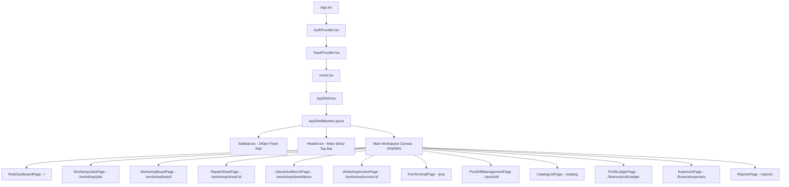

# Complete Route & Page Inventory Baseline Specification

**Document ID:** `TRANSFORMATION-01-ROUTE-INVENTORY`  
**System:** Antigravity Workshop & POS ERP System (Enterprise UI/UX Modernization)  
**Phase:** Phase 01 — Complete System Discovery & Visual Baseline  
**Date:** November 2026  
**Status:** Complete Architectural Baseline Finalized  

---

## 1. Executive Summary

This inventory establishes the comprehensive map of all active route endpoints, page components, layout containers, headers, tables, forms, modals, and interaction models for the system. 

The application encompasses **16 active route paths** structured across five core business domains:
1. **Executive & Dashboard Hub** (`/`, `/dashboard`)
2. **Workshop Operations & Vehicle Intake** (`/workshop/jobs`, `/workshop/board`, `/workshop/sheet`, `/workshop/new`, `/workshop/sheet/:id`, `/workshop/sheet/demo`, `/workshop/invoice/:id`)
3. **Showroom & Counter Point of Sale (POS)** (`/pos`, `/pos/shift`)
4. **Spare Parts & Labor Catalog** (`/catalog`)
5. **Finance, Overheads & Executive Analytics** (`/finance/profit-ledger`, `/finance/expenses`, `/reports`)
6. **System Fallback** (`*`)

This document catalogs every route with its current componentry, local styling divergences, hardcoded design artifacts, responsive behaviors, and available user actions.

---

## 2. Complete Route Map & Component Architecture

### Route Map Summary Table

| Route Path | Page Component | File Location | Module | Layout Wrapper | Current Permission Guard |
| :--- | :--- | :--- | :--- | :--- | :--- |
| `/` | `RoleDashboardPage` | `src/features/dashboard/pages/RoleDashboardPage.tsx` | Dashboard & Executive | `AppShellMasterLayout` via `AppShell` | Open / Role-tailored |
| `/dashboard` | `RoleDashboardPage` | `src/features/dashboard/pages/RoleDashboardPage.tsx` | Dashboard & Executive | `AppShellMasterLayout` via `AppShell` | Open / Role-tailored |
| `/workshop/jobs` | `WorkshopJobsPage` | `src/features/workshop/pages/WorkshopJobsPage.tsx` | Workshop Operations | `AppShellMasterLayout` via `AppShell` | Open (Role perspective tailored) |
| `/workshop/board` | `WorkshopBoardPage` | `src/features/workshop/pages/WorkshopBoardPage.tsx` | Workshop Operations | `AppShellMasterLayout` via `AppShell` | Open (Role perspective tailored) |
| `/workshop/sheet` | `RepairSheetPage` | `src/features/workshop/pages/RepairSheetPage.tsx` | Workshop Operations | `AppShellMasterLayout` via `AppShell` | Open (Creation / Intake mode) |
| `/workshop/new` | `RepairSheetPage` | `src/features/workshop/pages/RepairSheetPage.tsx` | Workshop Operations | `AppShellMasterLayout` via `AppShell` | Open (Creation alias) |
| `/workshop/sheet/:id` | `RepairSheetPage` | `src/features/workshop/pages/RepairSheetPage.tsx` | Workshop Operations | `AppShellMasterLayout` via `AppShell` | Open (Parametric record editor) |
| `/workshop/sheet/demo` | `InteractiveBenchPage` | `src/features/workshop/pages/InteractiveBenchPage.tsx` | Workshop Operations | `AppShellMasterLayout` via `AppShell` | Open (Phase 1 Engineering Bench) |
| `/workshop/invoice/:id`| `WorkshopInvoicePage` | `src/features/workshop/pages/WorkshopInvoicePage.tsx` | Workshop Operations | `AppShellMasterLayout` via `AppShell` | Open (Settlement & Invoicing) |
| `/pos` | `PosTerminalPage` | `src/features/pos/pages/PosTerminalPage.tsx` | Counter POS | `AppShellMasterLayout` via `AppShell` | `canAccessPos` |
| `/pos/shift` | `PosShiftManagementPage` | `src/features/pos/pages/PosShiftManagementPage.tsx` | Counter POS | `AppShellMasterLayout` via `AppShell` | `canAccessPos` |
| `/catalog` | `CatalogListPage` | `src/features/catalog/pages/CatalogListPage.tsx` | Parts Catalog | `AppShellMasterLayout` via `AppShell` | `canManageCatalog` |
| `/finance/profit-ledger`| `ProfitLedgerPage` | `src/features/finance-reports/pages/ProfitLedgerPage.tsx` | Finance & Reports | `AppShellMasterLayout` via `AppShell` | `canAccessFinance` |
| `/finance/expenses` | `ExpensesPage` | `src/features/finance-reports/pages/ExpensesPage.tsx` | Finance & Reports | `AppShellMasterLayout` via `AppShell` | `canAccessFinance` |
| `/reports` | `ReportsPage` | `src/features/finance-reports/pages/ReportsPage.tsx` | Finance & Reports | `AppShellMasterLayout` via `AppShell` | `canAccessReports` (`OWNER`, `WORKSHOP_MANAGER`) |
| `*` | `NotFoundPage` | `src/app/pages/NotFoundPage.tsx` | Core Shell | `AppShellMasterLayout` via `AppShell` | Fallback |

---

## 3. Route-by-Route Deep Inspection Specification

### 3.1 Route: `/` and `/dashboard` (Executive & Operational Dashboard)
- **Component & Location:** `RoleDashboardPage` (`src/features/dashboard/pages/RoleDashboardPage.tsx`)
- **Layout Wrapper:** `AppShell` wrapping `AppShellMasterLayout` (fixed left rail, 64px header, fluid canvas).
- **Page Header Implementation:**
  - Header displays greeting block: `"Welcome back, [User Name]"` with inline uppercase role badge (`OWNER`, `WORKSHOP_MANAGER`, etc.).
  - Right action cluster includes date badge (`Today, Nov 3`) and contextual quick launch pills (`[+ New Repair Sheet]`, `[Open POS]`).
- **Cards & Summaries Used:**
  - `HeroKpiCardObsidian` / `StatCard`: Today's Gross Sales, Active Floor Jobs, Pending Insurance Claims.
  - Secret cost privacy placeholder (`"Internal Buying Costs & Gross Profit hidden. Toggle 'Costs: ON' in header to reveal."`).
  - Donut chart card (`Workshop Bay Status` with 4-segment operational breakdown: In Progress, Waiting Parts, Insurance Pending, Ready for Delivery).
  - Area chart / Bar histogram (`Revenue & Profit Overview` showing 7-day volume with peak day highlight).
- **Table Implementation:**
  - `Recent Workshop Jobs & Counter Sales` table (Job ID, Vehicle & model, Customer/insurance, Document stage, Floor status, Amount, Action).
- **Form & Selector Implementation:**
  - Omnibox `⌘K` global search in top bar; no inline form on dashboard.
- **Dialogs & Overlays:**
  - Navigation triggers directly to `/workshop/jobs`, `/workshop/board`, `/pos`.
- **Local Styling & Hardcoded Values:**
  - Hardcoded `#F95700` peak bar chart fills.
  - Inline flex structures with inconsistent margin gaps (`gap-4`, `gap-6`).
- **Responsive Behaviour:**
  - Grid collapses from 3-column / 2-column layout on desktop to single column stack on mobile/tablet.
- **Available Actions:**
  - Toggle stage drilldowns, quick jump to Job Sheet, Open POS, View all jobs link.

---

### 3.2 Route: `/workshop/jobs` (Workshop Job Sheet Register)
- **Component & Location:** `WorkshopJobsPage` (`src/features/workshop/pages/WorkshopJobsPage.tsx`)
- **Layout Wrapper:** `AppShellMasterLayout`.
- **Page Header Implementation:**
  - Title: `"Workshop Jobs & Collision Estimates"` with subtitle: `"Searchable repository for quotations, collision estimates, active job cards, and invoices."`
  - Action buttons: `[Reset Seeds]` and `[+ New Repair Sheet]`.
- **Cards & Summaries Used:**
  - Stage filter pill tabs (`All 5`, `Quotations 2`, `Estimates 1`, `Job Cards 1`, `Invoices 1`).
  - Floor status select dropdown (`All Floor Statuses`).
- **Table Implementation:**
  - High-density jobs register with 6 columns:
    1. `Job ID` & Date (stacked with relative timestamp).
    2. `Vehicle` (license plate badge `WP CAB-4521` + make/model + accident repair summary).
    3. `Customer & Insurer` (Customer name, phone, address + SLIC/Ceylinco badge).
    4. `Stage` & `Status` (Dual-badge cell: `ESTIMATE` + `Partially Paid` / `Waiting For Parts`).
    5. `Amount (Rs.)` (Monospace tabular figure).
    6. `Actions` (Primary contextual stage progression button `-> Job Card` / `-> Invoice` + `•••` action dropdown).
- **Form & Selector Implementation:**
  - Search bar input: `"Search by vehicle plate, job #, customer, or insurance..."`.
- **Dialogs & Overlays:**
  - Row quick-actions dropdown with Open, Convert, Print A4, Share via WhatsApp, Delete.
- **Local Styling & Hardcoded Values:**
  - Hardcoded badge colors in local helper functions; table borders use raw Tailwind borders.
- **Responsive Behaviour:**
  - Horizontal table overflow on mobile viewports; requires responsive column hiding.
- **Available Actions:**
  - Instant vehicle search, stage tab filter, floor status filter, direct stage conversion, A4 print generation, WhatsApp invoice preview.

---

### 3.3 Route: `/workshop/board` (Workshop Floor Status Kanban Board)
- **Component & Location:** `WorkshopBoardPage` (`src/features/workshop/pages/WorkshopBoardPage.tsx`)
- **Layout Wrapper:** `AppShellMasterLayout`.
- **Page Header Implementation:**
  - Title: `"Workshop Floor Status Board"` with subtitle: `"Monitor bay throughput, technician allocations, and vehicle turnaround."`
  - Switcher control: `[Kanban Board]` / `[Compact Floor List]`.
- **Cards & Summaries Used:**
  - 5 Kanban lane containers representing workflow milestones:
    1. `Intake & Estimating` (Count badge: `1`)
    2. `Insurance Pending` (Count badge: `1`)
    3. `In Bay / Active Repair` (Count badge: `1`)
    4. `Waiting for Parts` (Count badge: `1`)
    5. `Ready for Delivery` (Count badge: `1`)
  - Vehicle Job Cards inside lanes displaying:
    - License plate pill (`WP CAB-4521`).
    - Turnaround target badge (`4 Days Target`).
    - Vehicle make & model.
    - Assigned technician avatar & name.
    - Task checklist completion bar (`4/6 tasks completed — 67%`).
    - Primary progression CTA (`Approve & Move to Bay ->`, `Send to QC ->`, `Parts Received ->`).
- **Form & Selector Implementation:**
  - Plate search bar input + Technician filter dropdown + `"Blocked / Delayed Only"` checkbox toggle.
- **Dialogs & Overlays:**
  - Technician task checklist accordion drawer.
- **Local Styling & Hardcoded Values:**
  - Colored indicator dots on lane headers; fixed column minimum widths causing horizontal scrollbars on smaller viewports.
- **Responsive Behaviour:**
  - Board cards wrap or overflow horizontally on tablet screens below 1280px.
- **Available Actions:**
  - Move job between bays/stages, toggle task completion checkboxes, assign mechanics, print job card.

---

### 3.4 Route: `/workshop/sheet`, `/workshop/new`, `/workshop/sheet/:id` (Workshop Repair Sheet Document)
- **Component & Location:** `RepairSheetPage` (`src/features/workshop/pages/RepairSheetPage.tsx`)
- **Layout Wrapper:** `AppShellMasterLayout`.
- **Page Header Implementation:**
  - Document Title: `"Workshop Repair Sheet: [Plate Number]"` with active stage pill (`QUOTATION`, `ESTIMATE`, `JOB_CARD`, `INVOICE`).
  - Subtitle: Vehicle model + primary repair nature summary.
  - Stage Stepper: Interactive segmented tabs (`QUOTATION` -> `ESTIMATE` -> `JOB_CARD` -> `INVOICE`).
  - Action Bar: `[Admin Cost Mode Toggle]`, `[Convert to Job Card]`, `[Collect Payment]`, `[Print A4]`, `[WhatsApp]`, `[Save Sheet]`.
- **Cards & Summaries Used:**
  - Financial Summary Card Ribbon:
    1. `Customer Selling Total` (`Rs. 85,000.00` - Discount: `Rs. 2,500.00`).
    2. `Total Direct Buying Cost` (Locked behind padlock in staff mode; visible in Owner mode: `Rs. 52,800.00`).
    3. `Gross Profit & Margin` (`Rs. 32,200.00 | 37.88%`).
    4. `Split Billing Balance Due` (`Rs. 10,000.00` - Insurance Approved: `Rs. 70,000.00`).
  - Deduction inputs row: Overall Discount (Rs.), Insurance Approved Amount (Rs.), Customer Advance Paid (Rs.).
- **Form & Selector Implementation:**
  - **12-Field Vehicle & Customer Details Matrix (Zero CRM Intake):**
    1. Vehicle Number (`WP CAB-4521`) with smart history autocomplete trigger (`Auto-Fill Vehicle Details`).
    2. Vehicle Make (`Toyota`).
    3. Vehicle Model (`Corolla Axio`).
    4. Year of Make (`2018`).
    5. Vehicle Color (`Pearl White 070`).
    6. Chassis Number (`NZE141-9034821`).
    7. Days For Completion (`4 Days`).
    8. Nature of Repair (`Accident Damage Front Left Side & Bumper Replacement`).
    9. Name of Insurance (`Sri Lanka Insurance Corporation (SLIC)` with one-click presets: Sri, Ceylinco, Fairfirst, Allianz, AIA, Direct).
    10. Customer Information (`Kasun Perera - 077 889 1234 / No 45, Galle Road, Colombo 03`).
- **Table Implementation:**
  - **3 Distinct Repair Section Tables (`WorkshopTable.tsx`):**
    - Section 1: `1. LABOR - REMOVE & REASSEMBLE (R&R)`
    - Section 2: `2. LABOR - REPAIR (Tinkering & Paint)`
    - Section 3: `3. REPLACEMENT (Spare Parts & Materials)`
  - Columns per table:
    - Line item `#` (`01`, `02`).
    - Description (combobox supporting catalog search OR freeform typing).
    - Amount / Selling Price (Rs.).
    - Buying cost (Rs.) — *Owner/Manager cost visibility mode only*.
    - Line profit (Rs. & %) — *Owner/Manager cost visibility mode only*.
    - Delete line button.
- **Dialogs & Overlays:**
  - `PaymentCollectionModal` for logging advance deposits and settling customer balances.
  - `VehicleHistoryLookupPopover` displaying past repair visits for repeated plates.
  - A4 Print preview modal with price redaction switch.
- **Local Styling & Hardcoded Values:**
  - Section headers use dark slate `#0F172A` with inline green subtotal indicators (`Rs. 7,000.00`).
  - Buying cost columns styled with green tint `#F0FDF4`.
- **Responsive Behaviour:**
  - 12-field grid uses responsive grid classes (`grid-cols-1 md:grid-cols-2 lg:grid-cols-4`); line item table scrolls horizontally on small viewports.
- **Available Actions:**
  - Real-time row addition via `[+ Add Row]` or `[Enter]` key; auto-complete vehicle details; toggle cost privacy; convert stage; print A4; send WhatsApp quotation.

---

### 3.5 Route: `/workshop/sheet/demo` (Phase 1 Engineering & Interactive Test Bench)
- **Component & Location:** `InteractiveBenchPage` (`src/features/workshop/pages/InteractiveBenchPage.tsx`)
- **Layout Wrapper:** `AppShellMasterLayout`.
- **Page Header Implementation:**
  - Breadcrumb: `Workshop > Phase 1 Bench`.
  - Header actions: Shift open indicator, Costs ON toggle, Perspective switcher (`Owner / Director`).
- **Cards & Summaries Used:**
  - 4 Bench Mode Tabs:
    1. `1. Editable Workshop Tables (Keyboard Ready)`
    2. `2. A4 Workshop Print Preview`
    3. `3. 80mm POS Thermal Receipt`
    4. `4. Design System Primitives`
- **Table Implementation:**
  - Renders live 3-section table with keyboard shortcuts inspection panel.
- **Print Previews:**
  - Renders live DOM view of `A4WorkshopPrint.tsx` and `ThermalReceiptPrint.tsx`.
- **Usability Role:**
  - Serves as the interactive laboratory for testing keyboard interactions, print redactions, and calculation engines without affecting database records.

---

### 3.6 Route: `/workshop/invoice/:id` (Workshop Invoice & Payment Settlement)
- **Component & Location:** `WorkshopInvoicePage` (`src/features/workshop/pages/WorkshopInvoicePage.tsx`)
- **Layout Wrapper:** `AppShellMasterLayout`.
- **Page Header Implementation:**
  - Invoice title with formal invoice number, linked job card ID, and payment status badge (`PAID`, `PARTIAL`, `UNPAID`).
- **Cards & Summaries Used:**
  - Split settlement summary card: Total Invoiced, Insurance Receivable, Customer Excess Due, Paid Advance, Net Payable.
- **Table Implementation:**
  - Finalized line items ledger grouped by labor and parts.
- **Dialogs & Overlays:**
  - Direct print trigger for formal A4 Invoice and 80mm payment receipt.
- **Available Actions:**
  - Record payment, tender cash/card, print invoice, send payment receipt via WhatsApp.

---

### 3.7 Route: `/pos` (Counter POS Terminal)
- **Component & Location:** `PosTerminalPage` (`src/features/pos/pages/PosTerminalPage.tsx`)
- **Layout Wrapper:** `AppShellMasterLayout`.
- **Page Header Implementation:**
  - Header displays POS breadcrumbs, global search, shift status pill (`🟢 Shift Open` / `🔴 Shift Closed`), lock screen trigger, and quick launch buttons.
- **Layout Architecture (Split Workspace):**
  - Left / Main Area (65% width):
    - Barcode scanning input field with hardware scanner readiness indicator (`"Scan barcode or search catalog..."`).
    - Category filter pill bar (`All Items`, `Spare Parts`, `Lubricants & Fluids`, `Quick Services`).
    - Catalog product card grid (3 to 4 columns of touch-friendly cards showing SKU, part name, stock quantity badge, selling price, and orange `[+]` add button).
    - Quick custom item input bar at bottom (`+ Quick custom part / service description...`, Price input, `[+ Add]`).
  - Right Area (35% width - Persistent Cart Drawer):
    - Active customer context pill (`Walk-in Counter Sale` with `Change` button).
    - Active order items counter (`2 items`) with Park Cart and Clear Cart actions.
    - Cart items list with item name, unit price, quantity stepper `[-] [ 1 ] [+]`, inline discount input, line total, and remove icon.
    - Cart totals summary block: Subtotal, Extra Discount, Net Total (prominent `Rs. 16,700.00`).
    - Persistent checkout action buttons: `[Hold]`, `[Quick Cash]`, `[Pay / Split]`.
- **Dialogs & Overlays:**
  - `PosPaymentModal`: Multi-tender payment calculator (Cash, Card, Bank Transfer, Split).
  - `PosCustomItemModal`: On-the-fly item creation modal.
  - `PosReceiptModal`: 80mm thermal receipt preview.
  - `PosSalesHistoryModal`: Daily POS transactions register.
  - `PosShiftDrawerModal`: Shift float entry and cash-out reconciliation.
- **Local Styling & Hardcoded Values:**
  - Orange CTA `#F95700` on Pay button; persistent right rail uses `min-w-[360px]`.
- **Responsive Behaviour:**
  - On viewports < 1024px, the cart drawer shifts below the catalog grid or requires tabbed view toggling.
- **Available Actions:**
  - Real-time barcode scanning, category filtering, quantity stepping, customer switching, split payments, thermal receipt printing.

---

### 3.8 Route: `/pos/shift` (POS Shift Drawer & Petty Cash Cockpit)
- **Component & Location:** `PosShiftManagementPage` (`src/features/pos/pages/PosShiftManagementPage.tsx`)
- **Layout Wrapper:** `AppShellMasterLayout`.
- **Page Header Implementation:**
  - Title: `"POS Shift Drawer & Petty Cash Cockpit"` with badge: `REGISTER OPEN`.
  - Subtitle: `"Live cash drawer tracking, petty cash payouts, shift reconciliation, and audit logs."`
  - Action pills: Shift duration timer (`26h 44m 01s`), `[Petty Cash Out]`, `[Parked Carts (0)]`, `[Today's Receipts (1)]`, `[Switch Shift]`, `[Counter POS]`.
- **Cards & Summaries Used:**
  - 4 Primary Metric Tiles:
    1. `Opening Float`: `Rs. 15,000.00` (Initial drawer float provided at shift start).
    2. `Total Cash Sales`: `+Rs. 0.00` (Tendered in cash from completed counter orders).
    3. `Petty Cash Disbursed`: `-Rs. 0.00` (Disbursed directly for garage/shop daily expenses).
    4. `Expected Drawer Cash`: `Rs. 15,000.00` (`Float + Cash In + Cash Sales - Petty Cash Out`).
  - Secondary Tender Strip: Card Sales (Terminal): `Rs. 0.00`, Bank Transfer / QR: `Rs. 0.00`, Cash Drops In: `+Rs. 0.00`.
  - End of Shift Reconciliation Card:
    - Expected In Drawer calculation breakdown.
    - Physical Counted Cash (Rs.) input field (`15000`).
    - Semantic status badge (`Balanced`).
    - Destructive primary CTA: `[Lock Drawer & Finalize Shift]`.
- **Table Implementation:**
  - `Cash Drawer Movements & Expense Audit Log` table (Time, Type, Reason / Description, Amount, Staff Name).
- **Dialogs & Overlays:**
  - Petty Cash Out modal; Shift Closing Confirmation dialog.
- **Local Styling & Hardcoded Values:**
  - Bright red `#DC2626` text on petty cash disbursed; large display numbers for expected cash.
- **Responsive Behaviour:**
  - 4 summary cards collapse to 2x2 grid on tablet and 1-column on mobile.
- **Available Actions:**
  - Record cash drop/payout, recount drawer cash, finalize shift, switch active register.

---

### 3.9 Route: `/catalog` (Parts & Labor Catalog Management)
- **Component & Location:** `CatalogListPage` (`src/features/catalog/pages/CatalogListPage.tsx`)
- **Layout Wrapper:** `AppShellMasterLayout`.
- **Page Header Implementation:**
  - Title: `"Parts & Labor Catalog"` with subtitle: `"Manage spare parts, lubricants, barcodes, and standard labor presets."`
  - Header buttons: `[Reset Demo]` and `[+ Add Catalog Item]`.
- **Cards & Summaries Used:**
  - 4 Catalog Metric Tiles:
    1. `Total Catalog SKUs`: `21` (Active across system).
    2. `Avg Part Margin %`: `Confidential` (Hidden in staff mode; reveals `38.2%` in Owner mode).
    3. `Labor Presets`: `9` (R&R and repair operation presets).
    4. `Low Stock Alerts`: `3` (Clickable filter pill).
- **Filter Toolbar:**
  - Local search input: `"Search by SKU, barcode, name, or vehicle compatibility..."`.
  - Category pill tabs: `All 21`, `Spare Parts 7`, `Lubricants 5`, `Labor - R&R 4`, `Labor - Repair 5`.
  - Category dropdown select: `All Categories`.
  - Checkboxes: `[x] Low Stock Only`, `[x] Active Only`.
- **Table Implementation:**
  - High-density 10-column table:
    1. `SKU` (Monospace pill `PRT-TOY-BMP-F`).
    2. `Barcode` (`8901234567801`).
    3. `Type` (Semantic badge `Part` / `Labor`).
    4. `Description & Compatibility` (Bold name + compatible vehicles subtitle).
    5. `Category` (`Body & Exterior`, `Electrical`, etc.).
    6. `UOM` (`pcs`, `sets`, `cans`, `liters`).
    7. `Stock` (Pill badge: green `4 pcs`, amber `2 pcs LOW STOCK ALERT`).
    8. `Buying Cost` (Visible only in Cost Mode: `Rs. 24,000.00`).
    9. `Selling Price` (Bold tabular figure `Rs. 38,000.00`).
    10. `Status` (Active toggle switch) & `Actions` (Edit pencil, adjust stock icon).
- **Dialogs & Overlays:**
  - `CatalogItemDialog`: New/Edit catalog part modal with margin calculator.
  - `StockAdjustDialog`: Inventory increment/decrement with reason notes.
- **Local Styling & Hardcoded Values:**
  - Switch component styling with iOS toggle classes; margin indicators turn green/amber/red.
- **Responsive Behaviour:**
  - Table requires horizontal scroll on mobile; cards in grid mode adapt cleanly.
- **Available Actions:**
  - Search, filter by category/low stock, toggle item active status, adjust stock levels, add new parts.

---

### 3.10 Route: `/finance/profit-ledger` (Executive Profit & Financial Ledger)
- **Component & Location:** `ProfitLedgerPage` (`src/features/finance-reports/pages/ProfitLedgerPage.tsx`)
- **Layout Wrapper:** `AppShellMasterLayout`.
- **Page Header Implementation:**
  - Title: `"Profit & Financial Ledger"` with subtitle: `"Unified gross revenue, direct part/sublet costs, and net operating profit."`
  - Action buttons: `[Shared-Screen Privacy]`, Period filter dropdown (`All Time`, `This Month`, etc.), `[Shop Expenses]`, `[+ Record Expense]`.
- **Cards & Summaries Used:**
  - 5 Financial Waterfall Tiles:
    1. `NET SALES REVENUE`: `Rs. 59,200.00` (Workshop + POS Walk-in).
    2. `TOTAL DIRECT COST`: `Rs. 36,700.00` (Parts buying + Sublet labor).
    3. `GROSS PROFIT`: `Rs. 22,500.00` with badge `38.0% Margin`.
    4. `SHOP OVERHEADS`: `Rs. 119,450.00` (Direct shop expenses).
    5. `NET OPERATING PROFIT`: `Rs. -96,950.00` with badge `Deficit` (Gross Profit - Overheads).
  - 3 Stream Breakdown Comparison Cards:
    - `Workshop Labor`: Revenue `Rs. 14,500.00`, Direct Costs `Rs. 4,000.00`, Margin `72.4%`.
    - `Workshop Parts`: Revenue `Rs. 28,000.00`, Buying Costs `Rs. 20,100.00`, Margin `28.2%`.
    - `Counter POS Sales`: Revenue `Rs. 16,700.00`, Buying Costs `Rs. 12,600.00`, Margin `24.6%`.
  - Outstanding Receivables pill: `Rs. 209,500.00`.
- **Table Implementation:**
  - `UnifiedProfitLedgerTable.tsx` / Chronological Ledger (8 records):
    - Filter tabs: `All Transactions`, `Workshop Invoices`, `POS Sales`, `Shop Expenses`.
    - Date & time, Reference ID (linked to invoice/sheet), Source, Customer / vehicle, Description, Net selling price, Direct Cost, Gross Profit, Margin %.
- **Dialogs & Overlays:**
  - `DailyExpenseModal` for recording ad-hoc expense vouchers.
  - CSV export trigger.
- **Local Styling & Hardcoded Values:**
  - Dark obsidian card for Net Operating Profit; financial figures enforce tabular numerals.
- **Responsive Behaviour:**
  - Waterfall ribbon stacks into 2x2 grid on tablet; horizontal table scrolling on mobile.
- **Available Actions:**
  - Filter by period and transaction source, inspect line profit, export ledger CSV, record expense.

---

### 3.11 Route: `/finance/expenses` (Shop Expenses & Overheads Workspace)
- **Component & Location:** `ExpensesPage` (`src/features/finance-reports/pages/ExpensesPage.tsx`)
- **Layout Wrapper:** `AppShellMasterLayout`.
- **Page Header Implementation:**
  - Title: `"Shop Expenses & Overheads"` with subtitle: `"Petty cash disbursements, CEB electricity, welding consumables, and sublet lathe bills."`
  - Action buttons: `[Refresh]`, `[Profit Ledger]`, `[+ Record Expense Voucher]`.
- **Cards & Summaries Used:**
  - 4 Expense Summary Cards:
    1. `Total Filtered Overheads`: `Rs. 119,450.00` (6 logged expense vouchers).
    2. `POS Drawer Cash-Outs`: `Rs. 5,450.00` (Petty cash deducted from active shifts).
    3. `Main Cash & Cheques`: `Rs. 114,000.00` (Premises lease, utilities & sublet).
    4. `Top Overhead Category`: `Rent & Premises` (`Rs. 85,000.00`).
  - Inline Quick Expense Entry Form (`DailyShopExpenseEntryForm.tsx`):
    - Overhead Category Badges: `Rent & Premises`, `CEB Electricity & Water`, `Welding Gas & Consumables`, `Sublet Lathe / Machining`, `Staff Refreshments & Tea`, `Other Garage Overheads`.
    - Voucher Date picker, Category dropdown select, Description input, Receipt/Bill # input, Expense Amount (Rs.) input, Payment Source selector (`POS Cash Drawer` vs `Main Cash / Safe`).
    - Live sync indicator: `"Automatic Drawer Sync: Drawer cash-outs deduct live from active register shift."`
- **Table Implementation:**
  - `Logged Expense Vouchers (6)` Table:
    - Filters: Category filter dropdown, Payment Source filter dropdown, Description search bar.
    - Columns: Date, Voucher # (`exp-2026-0003`), Category badge, Description / details, Payment source indicator, Recorded By, Amount (Rs.), Delete action icon.
- **Dialogs & Overlays:**
  - Voucher deletion confirmation dialog.
- **Local Styling & Hardcoded Values:**
  - Category badges with local color mappings (`#FEF2F2`, `#EFF6FF`, etc.).
- **Responsive Behaviour:**
  - Inline entry form shifts to vertical single-column on mobile.
- **Available Actions:**
  - Direct voucher entry, POS drawer reconciliation sync, voucher category filtering, voucher deletion.

---

### 3.12 Route: `/reports` (Executive Reports & Analytics Hub)
- **Component & Location:** `ReportsPage` (`src/features/finance-reports/pages/ReportsPage.tsx`)
- **Layout Wrapper:** `AppShellMasterLayout`.
- **Page Header Implementation:**
  - Title: `"Executive Reports & Analytics Dashboards"` with subtitle: `"Multi-stream sales margins, uncollected insurance claim aging, mechanic turnaround velocity, and fast-moving spare parts."`
  - Header actions: `[Export CSV v]`, `[Refresh]`.
- **Tabbed Analytics Architecture:**
  - 4 Primary Analytic Tabs:
    1. `Sales & Gross Profit (25% Margin)`
    2. `Insurance Claim Aging (2 Claims)`
    3. `Technician Velocity (5 Techs)`
    4. `Inventory Velocity & Alerts (3 Alerts)`
  - Period toolbar: `Today`, `Week`, `Month`, `Quarter`, `Custom`, Year picker (`2026`).
- **Tab 1: Sales & Gross Profit (`DateRangeSalesProfitTab.tsx`):**
  - KPI Row: Total Net Revenue (`Rs. 16,700.00`), Direct Buying / Sublet Cost (`Rs. 12,600.00`), Combined Gross Profit (`Rs. 4,100.00`), Overall Gross Margin % (`24.6%`).
  - Visualizations:
    - `Revenue & Gross Profit Stream Curves` (Smoothed area spline comparing Revenue Trend vs Gross Profit Trend).
    - `Revenue Allocation` Donut Chart (Labor R&R, Labor Repair, Replacement Parts, Counter POS).
    - `Workshop Streams Comparison & Velocity` 4-Card Grid.
    - `Comprehensive Revenue Stream Summary` structured table.
- **Tab 2: Insurance Aging (`InsuranceAgingTab.tsx`):**
  - Aging buckets: `0–15 Days`, `16–30 Days`, `30+ Days`.
  - Claim receivables ledger with insurance company, claim ref, vehicle, assessor, and overdue status.
- **Tab 3: Technician Velocity (`TechnicianVelocityTab.tsx`):**
  - Mechanic scorecard table: Completed jobs, active tasks, billed hours, on-time delivery rate.
- **Tab 4: Fast Moving Parts (`FastMovingPartsAlertsTab.tsx`):**
  - Stock velocity ranking, reorder alert threshold indicators, consumption rate.
- **Dialogs & Overlays:**
  - CSV / PDF export menu.
- **Responsive Behaviour:**
  - Complex charts adjust height; donut chart legends wrap below 1024px.
- **Available Actions:**
  - Period cycling, report tab navigation, chart series toggling, CSV download.

---

### 3.13 Route: `*` (Not Found Fallback)
- **Component & Location:** `NotFoundPage` (`src/app/pages/NotFoundPage.tsx`)
- **Layout Wrapper:** `AppShellMasterLayout`.
- **Structure:** Clean porcelain canvas card with 404 heading, explanatory message, and `[Return to Dashboard]` button.

---

## 4. Layout & Navigation Hierarchy Inspection

### Layout Analysis:
1. **Sidebar (`src/app/layout/Sidebar.tsx`):**
   - Width: 240px (`w-60`), fixed desktop rail with mobile off-canvas drawer.
   - Organized into 4 uppercase categories:
     - `WORKSHOP`: Dashboard, Workshop Jobs, Status Board, New Repair Sheet.
     - `COUNTER POS`: Counter POS, Shift & Drawer.
     - `CATALOG`: Parts & Catalog.
     - `FINANCE & REPORTS`: Profit Ledger, Shop Expenses, Reports & Aging.
   - Pinned footer widgets: Onboarding checklist progress strip (`6/7`) + User Account card (`Jagath Perera / OWNER`).
2. **Global Header (`src/app/layout/Header.tsx`):**
   - Height: 64px, translucent acrylic blur (`backdrop-blur-md`).
   - Breadcrumb navigation trail.
   - Universal Spotlight search input with `⌘K` keyboard trigger and live search result dropdown.
   - Register shift pill (`Shift Closed` / `Shift Open`).
   - Privacy padlock toggle (`Costs: ON` / `Costs: OFF`).
   - Role perspective selector (`OWNER`, `WORKSHOP_MANAGER`, `SERVICE_ADVISOR`, `CASHIER`, `TECHNICIAN`).
   - Global quick action triggers: `[+ New Repair Sheet]` (Terracotta) and `[Open POS]` (Obsidian).

---

## 5. Architectural Findings & Remediation Targets for Phase 01

1. **Header Action Redundancy:**
   - Both the global header (`Header.tsx`) and individual page headers (`WorkshopJobsPage`, `RoleDashboardPage`) render identical `+ New Repair Sheet` and `Open POS` buttons, causing visual competition.
2. **Inconsistent Breadcrumbs:**
   - Some pages rely on `Header.tsx` breadcrumbs, while other pages define local back-links (`< Jobs History`) or duplicated breadcrumbs inside the content canvas.
3. **Hardcoded Color Codes:**
   - Several pages use inline hex codes (`#F95700`, `#0F172A`, `#FFF3ED`, `#EA580C`, `#ECFDF5`) rather than semantic Tailwind classes or centralized CSS custom properties.
4. **Table Density Disparity:**
   - `WorkshopJobsPage` and `CatalogListPage` utilize dense, compact row heights (~48–52px), whereas `ExpensesPage` and `ReportsPage` revenue stream tables utilize looser, inconsistent vertical padding.
5. **Mobile Viewport Overflow:**
   - Multi-column tables (`CatalogListPage`, `WorkshopJobsPage`) and the 5-column Kanban board (`WorkshopBoardPage`) produce horizontal scrollbars on viewports smaller than 1024px without responsive column prioritization.

---

## 6. Verification & Sign-off

- **Total Active Routes Cataloged:** 16 routes mapped across 5 functional domains.
- **Component File Verification:** All 16 route page components exist and compile cleanly.
- **Baseline Integrity:** All existing business logic, validation rules, state machines, and calculations are documented and protected from modification.
